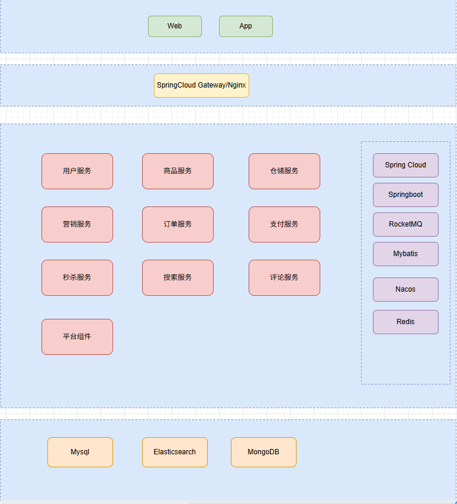

# 从0到1：电商系统实战（全业务闭环 \+ 高并发 \+ 数据一致性）》课程大纲

# 1\.课程介绍

## 1\. 系统架构

### 1\.架构图

### 2\.架构介绍

#### 1\.分层架构介绍

- 接入层（入口）：支持 Web 端与 App 端多终端接入，面向 C 端用户提供服务入口。

- 网关层（路由）：通过 SpringCloud Gateway / Nginx 承担统一流量入口、路由转发和限流熔断，屏蔽后端服务细节。

- 业务服务层（核心）：按领域拆分为 9 个微服务（用户、商品、仓储、营销、订单、支付、秒杀、搜索、评论），并将 平台组件 作为横向支撑，保障分布式场景下的消息可靠、任务调度和配置一致性。

- 技术底座（中间件）：整合 Spring Cloud 全家桶、RocketMQ（异步解耦）、Nacos（注册配置）、Redis（缓存加速）及 MyBatis（ORM），提供微服务治理与高性能数据交互能力。

- 数据存储层（持久化）：采用 混合存储 策略——MySQL 存储事务性核心数据，Elasticsearch 支撑复杂搜索与模糊查询，MongoDB 存储海量文档型日志或评论数据。

#### 2\.服务能力

1\.用户服务

统一用户注册登录、多端身份管理、收货地址维护；配套登录日志、用户基础数据全套表结构，支撑 C 端身份基础链路。

2\.商品服务

商品 SKU / 分类 / 品牌全生命周期管理，购物车 CRUD；自研双层销售库存，支持预售、分区售卖、多渠道库存调配，配套商品版本、用户库存流水数据表。

3\.仓储服务

采购入库、销售出库、售后逆向入库全履约流程；实物库存管控，实现库存 T\+1 对账，区分供应商、多仓库实物数据，解决库存数据漂移问题。

4\.营销服务

优惠券全生命周期管控，模板、发放、作废、核销完整闭环；记录优惠券使用关联订单，支撑下单自动抵扣营销能力。

5\.订单服务

单笔下单、购物车多店铺自动拆单、支付同步、取消 / 售后逆向、出库发货全链路；基于状态机 \+ 事件溯源存储订单轨迹，联动物流轨迹管理。

6\.支付服务

统一交易中台，支持单笔 / 合并批量交易；钱包充值、余额支付、提现、多渠道三方支付；退款、分润清分、双层资金对账，完整资金安全闭环。

7\.秒杀服务

商品 / 优惠券双秒杀体系；热点缓存分片、动态 Token\+URL 防刷；双秒杀模式（Redis 极速扣减 / MQ 排队强防超卖），TCC 生成秒杀订单，结果轮询查询。

8\.搜索服务

ES 四层检索架构：多路召回、自定义粗排打分、LR 精排、运营规则重排；实现拼音纠错、智能搜索提示，解决分库分表模糊查询瓶颈。

9\.评论服务

商品评论发布、高并发点赞；Redis 原子去重计数，MQ 异步落库保证最终一致性，批量查询优化杜绝 N\+1 查询。

10\.平台组件

1\.可靠 MQ 发送组件

事务同步发消息，保证本地业务与消息原子一致；三级阶梯延迟重试、时间轮调度，定时任务宕机兜底，分布式锁防集群重复重试，消息不丢不重。

2\.多实例定时动态分片

去中心化分片分配，多实例任务隔离避免重复执行；基于 Redis 维护实例编号，取模分页过滤，弹性扩缩容无单点。

3\.MQ 可靠消费组件

AOP 自动幂等、分布式锁防重复消费；18 级阶梯延迟重试，时间轮异步调度，死信隔离，定时任务补偿失败消息，反射处理避免 AOP 递归死循环。

4\.Nacos 动态配置组件

全局配置热更新无需重启服务；统一监听门面、标准化扩展接口，观察者 / 适配器模式解耦 SDK，支持配置发布、日志记录、低成本迁移配置中心。

## 2\. 适合谁学

- 1年\+Java开发

- 准备跳槽到电商/互联网中大厂，需要项目经验背书

- 已经在做业务开发，但没接触过真正的高并发场景

## 3\. 课程核心价值

### 1\.为什么选这套京东级电商实战？

#### 1 为什么选电商

- 业务最复杂：覆盖高并发、分布式事务、资金安全、分库分表、对账、逆向流程

- 面试最刚需：订单 / 库存 / 支付 / 秒杀是大厂必考核心场景

- 通用性最强：架构思想可平移到 SaaS、金融、直播、出行等互联网行业

#### 2 课程 8 大核心优势

1. 全业务闭环：下单 / 支付 / 退款 / 对账 / 仓储 / 秒杀 / 售后全覆盖

2. 工业级 TCC：Hmily 源码 \+ 三阶段 \+ 幂等 / 空回滚 / 防悬挂全套落地

3. 双层库存架构：解决超卖、预售、分仓、数据漂移

4. 自研基建组件：可靠 MQ、定时分片、动态配置、消费重试框架

5. 高可用体系：缓存防护、熔断、降级、超时漏斗、限流防刷

6. 资金全链路：钱包 / 充值 / 提现 / 清分 / 对账 / 长短款处理

7. 分库分表 \+ ES：海量数据存储 \+ 高性能搜索

8. 企业级安全：多租户、双 Token、接口签名、防重放

### 2\.AI 时代为什么还要学？

1. AI 只会 CRUD，不会分布式容错 / 故障兜底

2. AI 不懂业务约束与架构取舍

3. 企业高薪看：排障、兜底、设计，AI 无法替代

4. 底层架构思想十年不变，是长期护城河

5. 面试能讲出生产级落地方案，直接拉开差距

### 3\.学完掌握 7 大能力

1. 全链路业务：电商微服务 \+ 正向逆向全流程

2. 分布式一致性：TCC、状态机、事件驱动、双层库存、双对账

3. 海量数据：分库分表、MySQL\+ES、金融级表设计

4. 高并发高可用：缓存、限流、熔断、降级、异步解耦

5. 自研组件：可靠消息、重试幂等、定时分片、动态配置

6. 安全架构：多租户、鉴权、签名、防篡改防重放

7. 工程 \& 面试：DDD、防御编程、面试题全套落地案例

## 4\.岗位与薪资

目标岗位

真实薪资范围（2026年市场）

为什么最低25w

你可能会问：凭什么说最低25w？

因为课程覆盖的技术栈，直接对应的是电商行业最核心的岗位需求：

1. **订单\+支付\+库存** —— 每个电商公司都有，面试必问

2. **秒杀\+高并发** —— 大厂面试的区分度最高的考点，会这个和不会这个，薪资差一个档次

3. **MQ可靠性\+分布式事务** —— 中高级岗位的基本要求，也是面试中最容易拉开差距的部分

4. **分库分表\+Redis高可用** —— 数据量上来之后的刚需，会的人不多

一个掌握了以上内容的Java开发，在任何一家电商公司（不管是阿里系、京东系、还是创业公司），面试表现正常的情况下：

- 一线城市（北上深杭）：起步月薪15K以上，加上年终就是25w\+

- 二线城市（广成武）：起步月薪12K以上，年包18w\+

**注意**：25w是一线城市的保底数字，不是天花板。3年经验\+这套技术栈，35w\-50w是正常的中位数区间。

岗位JD匹配度

以Boss直聘上真实的JD为例，筛选"Java \+ 电商 \+ 高并发"：

**JD样本1：某电商公司 Java开发（1\-3年）**

> 要求：熟悉微服务架构，有订单/支付/库存开发经验，了解MQ消息可靠性，熟悉Redis缓存方案 薪资：18K\-30K
> 
> 

→ 课程覆盖：订单服务（状态机）、支付服务（对账\+幂等）、仓储服务、MQ可靠消息、Redis高可用 ✅

**JD样本2：某互联网大厂 高级Java（3\-5年）**

> 要求：有高并发场景经验（秒杀/抢购），熟悉分布式事务（TCC/可靠消息），了解分库分表方案 薪资：30K\-50K
> 
> 

→ 课程覆盖：秒杀全链路、TCC分布式事务、分库分表、接口编排 ✅

**JD样本3：某新零售公司 架构师**

> 要求：主导过电商系统架构设计，熟悉CAP理论，有多租户/SaaS经验，能做技术选型和trade\-off 薪资：40K\-60K
> 
> 

→ 课程覆盖：9大微服务完整架构设计、多租户架构、动态配置平台、架构模式（状态机/事件驱动/聚合事务边界）✅

一句话

这门课教的不是"怎么写代码"，是"怎么拿25w以上Offer的技术能力"。代码谁都会写，但能讲清楚架构选型、能扛住面试官追问"为什么这么设计"的人，才值这个价

## 5\.重磅配套福利

1\.全套可直接运行的工程代码 完整 Web \+ App 后端 Java 源码、微服务架构、

数据库脚本、配置文件，拿来就能跑、能写进简历

2\.配套项目架构设计 \+ 源码解析 \+ 踩坑笔记

3\.真实架构师面试题宝典（总结汇总） 订单 / 库存 / 支付 / 秒杀 / 分布式事务 

/ 高并发 / 对账 / 分库分表，高频面试题 \+ 标准答案 \+ 项目实战话术

4\.一对一面试指导 简历项目包装 \+ 项目讲解逻辑 \+ 模拟面试 \+ 面试复盘，

帮你把课程内容真正讲进面试官心里

# 2\.核心业务全流程串联

## 1\.用户服务

1\.用户注册与登录流程

2\. 收货地址管理流程

3\.核心数据表设计

address（收货地址表）

user（用户表）

user\_login\_log（登录日志表）

## 2\.商品服务

1\.商品管理流程

2\.购物车流程

3\. 库存管理流程

4\. 核心数据表设计

基础商品（base\_goods / base\_goods\_sku）

商品与属性（goods / goods\_sku / goods\_attribute）

品牌与分类（goods\_brand / goods\_category）

商品历史记录（goods\_history\_version / goods\_sku\_history\_version）

店铺（shop）

用户侧库存（user\_stock / user\_stock\_flow / user\_stock\_preorder\_publish\_log）

购物车（cart）

## 3\.仓储服务

1\.采购与入库流程

2\. 销售出库流程

3\. 售后入库单流程

4\.仓储库存对账

5\. 核心数据表设计

出入库单（purchase\_in\_stock\_order / sales\_out\_stock\_order / after\_sales\_int\_stock\_order / in\_out\_stock\_order\_item）

采购单（purchase\_order / purchase\_order\_item）

库存与流水（stock / stock\_flow / stock\_preorder\_publish\_log）

库存对账（reconciliation\_diff / reconciliation\_order\_detail）

供应商与仓库（supplier / warehouse）

## 4\.营销服务

1\.优惠券全生命周期流程

2\.核心数据表设计

coupon（用户优惠券）

coupon\_template（优惠券模板）

coupon\_template\_history（优惠券模板历史）

coupon\_template\_revoke（优惠券作废记录）

order\_coupon（优惠券使用记录）

## 5\.订单服务

1\. 单笔下单流程

2\. 支付成功处理流程

3\. 取消订单流程

4\. 购物车结算与拆单流程

5\. 售后流程

6\.核心数据表设计

订单与订单项（orders / order\_item / main\_order）

订单状态溯源（order\_status\_trace）

售后单（after\_sales\_order / after\_sales\_order\_item）

物流与轨迹（shipping\_info / shipping\_track / express）

## 6\.支付服务

1\.支付全生命周期流程

2\.对账全生命周期流程

3\.钱包账户管理流程

4\. 余额支付流程

5\.取消回滚流程

6\.提现流程

7\. 钱包充值流程

8\. 核心数据表设计

交易表（trade\_order / bath\_trade\_order / prepay\_pay\_type）

退款与转账（refund\_order / transfer\_order）

支付流水（pay\_order\_flow / refund\_order\_flow / transfer\_order\_flow）

对账表（reconciliation\_diff / reconciliation\_job\_log / channel\_bill\_download\_progress / trade\_fund\_bill\_detail / signcustomer\_fund\_bill\_detail）

钱包表（wallet\_account / wallet\_account\_flow / wallet\_withdraw）

清分结算（pay\_account / clearing\_detail）

重试策略（pay\_compensate\_order\_retry\_policy）

## 7\.秒杀服务

1\. 秒杀核心流程

2\. 商品秒杀流程

3\.库存扣减流程

4\.订单生成流程

5\.秒杀结果查询流程

6\.优惠券秒杀流程

7\. 核心数据表设计

sec\_kill\_activity（秒杀活动表）

sec\_kill\_item（秒杀商品表）

sec\_kill\_record（秒杀记录表）

## 8\.搜索服务

1\.搜索架构

## 9\.评论服务

1\.评论发布流程

2\.点赞流程

# 3\.核心业务模块与技术深度拆解

## 1\.Hmily框架源码解析

从零吃透 Hmily\-TCC 框架：TCC 协议三阶段规范、AOP 拦截链路、源码级执行流程、本地/远程调用差异、容错恢复机制，以及与 Seata\-AT 的深度对比选型。

#### 课程亮点

- 以电商下单（订单/库存/商品三服务）为完整案例，手写 Try/Confirm/Cancel 伪代码，真正理解 TCC 补偿型事务的落地方式

- 深入 Hmily 源码拆解 AOP 切面拦截、Disruptor 异步调度、状态机驱动的全链路执行流程

- 对比 Hmily\-TCC 与 Seata\-AT 在侵入性、性能、锁机制、容错等 7 个维度的核心差异，给出金融/支付/库存等场景的明确选型建议

#### 1\.TCC 协议规范与三阶段模型

- 理解 TCC 作为补偿型分布式事务协议的本质定义，类比 HTTP 协议理解三阶段接口规范

- 掌握 Try 阶段"校验\+资源冻结预留"的核心原则：不做最终提交、保证可回滚、必须幂等

- 掌握 Confirm 阶段"最大努力重试、不允许失败"的提交语义与数据固化逻辑

- 掌握 Cancel 阶段"释放预留资源、数据归零"的回滚规则与幂等处理要求

- 学会以电商下单（订单/库存/商品三服务）为场景，完整编写每个服务的 Try/Confirm/Cancel 接口

#### 2\. Hmily 框架架构与核心注解

- 掌握 @HmilyTCC 注解的使用方式：指定 confirmMethod 与 cancelMethod，框架自动接管三阶段

- 理解 SpringHmilyTransactionAspect 切面拦截入口，从 ThreadLocal/Header 解析事务上下文并分发

- 理解 HmilyActionEnum 状态机枚举：PRE\_TRY→TRYING→CONFIRMING→CANCELING→DELETE→DEATH 的完整流转

- 理解 HmilyRoleEnum 角色枚举：START/PARTICIPANT/LOCAL/SPRING\_CLOUD 等角色如何决定执行逻辑

- 掌握 hmily\_transaction\_global 与 hmily\_transaction\_participant 两张核心表的设计与作用

#### 3\. 两阶段执行流程深度解析

- 掌握 Pre\-Try 前置准备：创建全局事务、创建发起者分支事务、初始化上下文、绑定 ThreadLocal

- 理解 Try 阶段执行成功后状态从 PRE\_TRY 流转为 TRYING，本地与远程参与者分别记录 participant

- 掌握 Confirm 全局提交流程：遍历所有参与者，区分本地反射与 RPC 远程调用执行 confirm 方法

- 掌握 Cancel 全局回滚流程：Try 异常/超时触发，更新状态为 CANCELING，批量执行回滚后标记 DELETE

- 理解分支事务只在执行前记录、Confirm/Cancel 执行后不额外写库的设计优化思路

#### 4\. 本地调用与 Feign 跨服务调用核心差异

- 掌握本地调用与 Feign 调用在事务角色、上下文传递、参与者记录、执行方式上的五大核心差异

- 理解本地调用通过 HmilyReflector 直接反射执行 confirm/cancel 方法的机制

- 掌握 Feign 调用通过 HmilyFeignInterceptor 将事务上下文写入 HTTP Header 的传递链路

- 理解接收方通过 HmilySpringCloudFilter 解析 Header、进入 ParticipantHmilyTccTransactionHandler 按状态分发执行的完整流程

- 学会根据角色（START/PARTICIPANT/LOCAL）判断框架走本地反射还是 RPC 远程调用的核心逻辑

#### 5\. 容错机制与技术选型

- 掌握 Hmily 内置定时扫描恢复机制：PRE\_TRY/TRYING 状态自动触发 Cancel，CONFIRMING 状态自动重试 Confirm

- 理解宕机重启后定时任务检测 TRYING 状态自动回滚、避免数据不一致的容错原理

- 掌握 Hmily\-TCC 与 Seata\-AT 在代码侵入性、一致性级别、性能开销、锁机制、容错能力等 7 个维度的核心差异

- 明确选型原则：普通业务用 Seata\-AT（零侵入开箱即用），金融/支付/库存等高并发核心业务用 Hmily\-TCC

- 理解 TCC 支持缓存、MQ、第三方接口等非 DB 操作的补偿，而 AT 仅支持数据库事务回滚的边界差异

## 2\.架构模式

### 1\.复杂业务架构之状态机架构模式

通过状态机实现复杂业务对象生命周期的显式化管理，确保业务对象按预定义路径单向推进，杜绝非法跳转与隐式逻辑。

#### 课程亮点

- 掌握状态机设计五大原则：单一职责、乐观锁幂等、无动作不设状态、禁止无约束回退、不定义失败状态

- 理解"状态代表现在该做什么，而不是刚才发生了什么"的核心哲学，避免僵尸状态

- 学会Hmily框架DEATH终态设计思想与订单系统CANCELLED的一致性映射

#### 1\.状态机核心问题与设计原则

- 掌握状态机解决的核心问题：显式化业务路径（当前状态\+触发事件=目标状态\+执行动作），治理对象生命周期

- 理解两类状态的本质区分：流转状态（存在可执行核心动作，向下流转）vs 终态（生命周期终点，不再流转但具备独立业务语义）

- 学会单一职责原则：链路中间流转状态必须绑定唯一正向核心业务动作，取消/终止类逆向操作为全局通用旁路事件

- 明确首尾状态的特殊约定：起始状态\(WAIT\_PAY\)允许无前驱，终止状态\(CLOSED/CANCELLED\)允许无后续

#### 2\. 状态机五大设计约束

- 掌握乐观锁幂等更新：状态流转必须基于version字段更新，affectedRows=0代表版本冲突需重试

- 理解"无业务动作不设计状态"：瞬时执行过程不建模防止状态爆炸，不设计"付款中""审核中"等瞬时状态

- 学会"禁止无约束逆向回退"原则：逆向流转必须在状态机中显式定义，且必须绑定完整补偿业务逻辑

- 理解为什么不定义"失败\(Failed\)"状态：失败是异常结果而非生命周期节点，状态代表"下一步"而非"过去时"

- 明确失败处理正确做法：状态停留原地\+重试机制，超时后由状态机迁移到终态\(CANCELLED\)

#### 3\. 状态机应用技巧与实战

- 掌握状态更新与业务动作解耦：先本地事务更新状态，再通过Spring Event或RocketMQ异步执行后续动作，避免长事务锁表

- 理解状态机事务要轻的核心原则：UPDATE status和业务动作\(如扣库存\)必须分离，事务提交后尽快释放资源

- 学会异步触发后续动作的两种方案：Spring事件\(单体适用\) vs RocketMQ可靠消息\(分布式推荐\)

#### 4\. Hmily框架状态机设计案例与理念统一

- 掌握Hmily状态机完整流转：TRYING→CONFIRMING/CANCELING→DELETE\(正常终态\)/DEATH\(异常终态\)

- 理解Hmily的精妙设计：动作执行失败=状态滞留\+重试（不切状态），重试次数耗尽才流转DEATH

- 学会为什么Hmily不定义FAILED：语义歧义（哪个阶段失败？）\+ 状态滞留（僵尸状态无出边），最终变成DEATH终结态

- 理解Hmily与订单系统的"大一统"映射：WAIT\_PAY≈CONFIRMING\(失败停留原地\)、CANCELLED≈DEATH\(边界条件触发需人工\)、CLOSED≈DELETE\(正常终态\)

### 2\.复杂业务架构之事件驱动架构模式

基于消息队列实现事件驱动架构，从"你调我"的耦合模式转变为"你发生，我响应"的反应式模式，实现系统的高扩展与高维护性。

#### 课程亮点

- 掌握事件驱动架构的核心价值：扩展性（加功能不求人）\+ 维护性（改代码不炸雷），变更风险隔离

- 理解三种MQ通信模式的适用场景：一对一（单执行）、一对多（广播扇出）、回调通知（异步闭环）

- 学会跨服务异步调用与流程编排的实战设计：支付回调、物流通知、多步骤串联编排

#### 1\. 事件驱动架构定义与核心价值

- 掌握事件驱动架构定义：系统围绕"不可变事实（事件）"运转，各服务通过事件总线（MQ）异步通信

- 理解扩展性优势：新增业务（加赠品、发积分）只需新写监听者，老服务零改动，消费者实例可水平扩展

- 理解维护性优势：每个服务只关心自己消费的事件，修改内部逻辑不影响上游，下游挂了消息持久化恢复后自动续传

- 明确"你发生，我响应"反应式模式的本质：变更风险隔离，耦合从代码层面转移到基础设施层面

#### 2\. 基础模式：一对一（竞争消费）

- 掌握一对一模式的核心机制：一条消息仅能被一个消费者消费，多消费者竞争关系谁先抢到谁处理

- 理解适用场景一：异步任务单执行——文件转码、订单发货、短信发送（同一任务只需处理一次）

- 理解适用场景二：削峰限流——下单扣库存、支付校验，避免重复执行业务

- 理解适用场景三：任务负载均衡——多实例服务分担压力，横向扩容提升处理速度

#### 3\. 进阶模式：一对多（广播扇出）

- 掌握一对多模式的核心机制：生产者发布事件到Topic，多个消费者各自绑定Topic，每个服务都能消费互不干扰

- 理解一对多模式的典型场景：一个事件触发多个下游响应（订单创建后→库存预留\+积分计算\+消息通知\+风控检测）

- 学会一对多模式的设计要点：每个消费者独立Group，消息持久化到所有订阅Group

#### 4\. 高阶模式：回调通知

- 掌握回调通知的完整流程：服务A发事件→服务B消费完成→B将结果发至回调队列→A监听回调接收结果

- 理解两种回调实现：同步回调（阻塞等待，不推荐）vs 异步回调（主流，发送后释放线程，收到回调再收尾）

- 学会回调通知的适用场景：跨服务异步调用（支付渠道/物流接口）、流程编排（审批/订单履约多步骤串联）、第三方异步通知对接

- 明确回调模式的核心价值：异步闭环，调用方无需轮询，下游处理完自动通知

### 3\.复杂业务架构之接口编排模式

在DDD四层架构中，应用层通过接口编排协调多个领域服务完成完整业务用例，将分布式事务与业务逻辑解耦。

#### 课程亮点

- 掌握DDD应用层编排的核心职责：协调领域服务、不包含业务规则、按顺序调用完成一个Use Case

- 理解下单接口编排的完整案例：库存预扣→优惠券锁定→交易单创建→订单创建，TCC事务贯穿全链路

- 学会"应用层很薄、领域层很厚"的设计哲学：应用层不包含if\-else业务规则，规则封装在领域服务或聚合根内部

#### 1\. 为什么需要接口编排

- 理解不做编排的后果：事务混乱、代码臃肿、领域污染、复用性差、维护成本爆炸

- 掌握接口编排的本质：将"多领域、多外部依赖、分布式事务"的复杂业务流程抽离到应用层统一调度

- 学会将零散原子能力串联成完整业务用例的设计思路

#### 2\. 下单接口编排完整案例

- 掌握startPlaceOrder编排四步法：扣减库存→使用优惠券→创建交易单→创建订单，@HmilyTCC注解贯穿全链路

- 理解每一步的TCC Try阶段语义：库存预扣（冻结）→优惠券锁定（标记已使用）→交易单待支付→订单暂存

- 学会参数载体设计：PlaceOrderDTO（命令对象，携带用户原始数据）vs OrderInitParamsBO（应用层内部流转参数）

- 明确返回结果设计：PlaceOrderVO仅包含订单号等前端必要信息，领域细节不透传

#### 3\. DDD分层架构中的编排定位

- 掌握DDD四层架构的职责划分：接口层\(Controller\)→应用层\(Application Service\)→领域层\(聚合根/实体/值对象\)→基础设施层\(仓储/RPC\)

- 理解应用层的核心定位：编排领域对象实现Use Case，不包含业务规则，只协调多个领域服务完成交易

- 学会各步骤的职责边界：应用层调用库存领域服务\(预扣\)、优惠券领域服务\(锁定\)、支付领域服务\(创建交易单\)、订单工厂\(创建聚合根\)

- 明确应用层与领域层的关键区分：应用层不包含if\-else业务规则（如"满减是否满足"），规则封装在领域服务或聚合根内部

#### 4\.接口编排的优点与架构价值

- 掌握三大优点：清晰事务边界（每个领域服务保证自己的TCC能力）、高内聚低耦合（通过领域服务接口协作）、符合DDD规范（应用服务很薄）

- 理解编排模式对分布式事务的解耦价值：领域层保持纯净，应用层负责流程协调

- 学会编排模式的可维护性：新增步骤只需在应用层添加调用，不影响领域服务实现

- 明确编排模式与状态机、事件驱动的协同关系：编排决定执行顺序，状态机控制流转路径，事件驱动解耦后续动作

### 4\.复杂业务架构之聚合事务边界与事件最终一致性

基于DDD聚合划分事务边界，边界内强一致ACID本地事务，边界间通过MQ事件异步协作实现最终一致性。

#### 课程亮点

- 学会事务性发件箱\(Outbox\)模式：业务数据与事件写入同一事务，保证"数据存了事件一定存了"

- 理解反模式危害：大事务锁竞争\+性能瓶颈\+不符合微服务独立部署，对比出事件驱动架构的优越性

#### 1\. 聚合划分与事务边界定义

- 学会"每个操作独立"的设计思路：订单聚合、库存聚合、积分聚合各自管理自己的事务，互不干扰

#### 2\.事务性发件箱\(Outbox\)模式

- 掌握Outbox核心机制：将"业务数据写入"和"事件写入发件箱表"放在同一个数据库事务中，保证原子性

- 理解Outbox表的作用：INSERT orders \+ INSERT order\_items \+ INSERT outbox在同一事务，COMMIT后数据与事件一致

- 学会消息转发进程设计：独立进程从outbox表读取记录并投递到MQ\(RabbitMQ/Kafka\)，解耦业务与消息发送

- 明确Outbox解决的核心问题：消除"业务成功但事件丢失"的风险，实现可靠消息投递

#### 3\.跨聚合事件驱动协作

- 掌握库存服务消费模式：监听OrderCreated事件→独立事务内扣减库存→乐观锁/行锁防超卖→消费失败MQ重试

- 理解积分服务消费模式：同样消费OrderCreated事件→独立事务内增加积分→与订单/库存事务完全解耦

- 学会最终一致性的含义与代价：短时间窗口内订单已存在但库存/积分可能未处理完成，MQ重试直至成功

- 明确这种模式的核心优势：各聚合独立部署、独立扩缩容、互不阻塞，符合微服务架构最佳实践

#### 4\.反模式对比与架构总结

- 理解反模式的危害：一个大事务包所有操作\(订单\+库存\+积分\)，导致inventory表和user\_points表被长事务锁住，严重锁竞争\+性能瓶颈

- 掌握正确架构的对比优势：父子表一个事务\+其他操作通过MQ异步处理，各聚合独立事务边界

- 学会反模式识别方法：@Transactional包裹多个非父子表的增删改查，跨表锁竞争，不符合微服务独立部署

- 明确"事务边界=聚合\+边界间事件驱动"是现代分布式系统最推崇的架构姿势

## 3\.库存系统

### 1\.电商库存系统设计

双库存模型架构总览：将库存数据抽象为"交易逻辑层"与"仓储物理层"两个独立视图，通过异步最终一致性实现系统解耦。

#### 课程亮点

- 掌握双层库存模型核心思想：仓储实物层与用户虚拟层分离，兼顾高并发性能与实物准确性

- 理解预售专属实物池设计：preStock与usableStock物理隔离，杜绝跨场景超卖

- 学会多渠道售卖的channelCode字段隔离方案，实现一套实物多平台独立售卖

#### 1\.双库存模型架构与表模型设计

- 掌握双库存模型定义：交易逻辑层（用户侧）与仓储物理层分离，通过异步最终一致性同步

- 理解仓储库存表核心字段：usableStock（可使用实物库存）、preStock（预售锁定实物库存）、skuCode（SKU最小销售单元标识）

- 理解用户侧库存表核心字段：usableStock/totalStock（前端可售虚拟额度）、channelCode（渠道隔离标识）

- 明确分渠道售卖设计：同一实物按channelCode分配独立虚拟额度，渠道间互不占用

#### 2\. 预售发布与库存划拨逻辑

- 掌握仓储侧实物拆分逻辑：发布时preStock增加、usableStock等量减少，从通用现货池划入预售专属实物池

- 理解用户侧同步释放售卖额度：totalStock增加与仓储preStock划拨量严格相等

- 明确"发布\-划拨"的核心理念：底层有多少预售实物，前台最多能产生多少预售订单，总量对等无差额

#### 3\. 下单\+出库完整扣减链路

- 掌握用户下单阶段：仅扣减上层用户侧虚拟额度，额度归零即刻拦截，不触碰底层实物

- 理解仓库出库阶段：仅消耗preStock预售专属实物池，usableStock通用现货完全不受影响

- 学会分层异步扣减策略：下单即时扣减反馈结果（高并发），出库延后扣减（真实履约）

- 明确该设计解决超卖的三大机制：实物预先隔离、虚拟额度前置限流、总量对等无差额

#### 4\. 防超卖机制与异常容错

- 掌握前台虚拟额度前置限流：并发下实时递减，额度耗尽直接拦截，彻底堵死并发超卖窗口

- 理解异常场景容错设计：退款/取消仅恢复用户侧虚拟额度；损耗仅调减preStock不污染现货；补货双向同步更新

- 明确多层防超卖体系：从源头（实物隔离）、并发（虚拟限流）、业务隔离（三层机制）全面杜绝超卖

### 2\.preStock预售库存机制

深入解析双层库存模型的表结构设计与preStock预售库存机制，实现仓储实物与用户售卖的解耦同步。

#### 课程亮点

- 掌握双层库存表深度设计：仓储侧usableStock\+preStock分离，用户侧新增地理位置字段支持分区匹配

- 理解preStock"先预留后出库"机制：发布预售时划拨实物，确保下单后实物一定在仓库等待发出

- 学会MQ驱动的库存发布同步链路：仓储侧划拨→MQ消息→用户侧增量更新，含幂等保障

#### 1\.双层库存表结构深度对比

- 掌握仓储库存表\(stock\)核心设计：usableStock（可使用实物，未授权销售）、preStock（预售库存，已授权销售但未出库）

- 理解用户侧库存表\(user\_stock\)扩展设计：在基础库存字段上冗余areaCode、latitude、longitude等地理位置信息

- 明确地理位置下沉到库存记录的优势：单表查询避免JOIN、高并发下性能更优、策略匹配更灵活

#### 2\.preStock预售库存设计原理

- 掌握preStock的核心作用：发布预售时从usableStock划拨，实物不动但账面锁定，代表"承诺给用户但还没发出的实物"

- 理解preStock与出库校验的关系：出库时只校验preStock而非usableStock，确保承诺的实物一定可发

- 学会preStock防超卖机制：即使仓储同时进行盘点、调拨、损耗，已预留的preStock始终被隔离保护

- 明确异步解耦下的数据一致性保障：仓储侧先记录承诺，用户侧通过MQ最终一致

#### 3\. 预售发布与库存同步核心链路

- 掌握仓储侧发布预售的完整流程：查库存→校验→usableStock减少\+preStock增加→乐观锁更新→发送MQ

- 理解用户侧消息消费逻辑：首次发布创建user\_stock记录，增量发布累加usableStock

- 学会MQ异步同步的幂等保障：通过UserStockPreorderPublishLogService记录接收日志，防止重复消费

- 明确"预售实物总量=前台可售预售额度"的总量对等原则

### 3\.多商城（多平台/多渠道）售卖

基于"发布\-回收"机制实现同一批实物在多平台灵活调配，解决多渠道库存隔离与动态分配难题。

#### 课程亮点

- 掌握"发布\-回收"库存调配机制：一套实物按publishPlatform虚拟出多份销售库存，运营可动态调配

- 理解MQ驱动的库存发布与回收链路：仓储侧划拨/回收→MQ消息→用户侧按平台隔离更新

- 学会多商城共享实物的架构设计：仓储只管实物总量，用户侧按平台隔离售卖额度

#### 1\.多商城场景的核心问题与模型设计

- 理解传统多商城库存的痛点：按渠道一次性分配无法调整，导致有的渠道积压、有的缺货

- 掌握当前模型的核心设计：仓储侧不区分商城只管实物总量，用户侧通过publishPlatform字段按商城维度虚拟出多份销售库存

- 学会发布日志表\(UserStockPreorderPublishLogDO\)的设计：记录每次向哪个商场发布了多少，保障幂等

#### 2\. 多商城库存发布流程

- 掌握仓储侧发布流程：从usableStock划拨到preStock→发送MQ消息并携带publishPlatform标识

#### 3\. 多商城库存回收流程

- 理解回收场景的业务价值：大促结束后将滞销渠道的剩余库存转给热销渠道

- 掌握仓储侧回收逻辑：preStock减少、usableStock增加（实物回到仓库可用池）→发送回收MQ

- 学会用户侧按平台回收：根据publishPlatform精确定位并扣减对应商城的可用库存

- 明确回收机制对运营灵活性的提升：实时监控各渠道销售，动态调配避免"旱的旱死、涝的涝死"

#### 4\.发布\-回收机制的核心优势与架构总结

- 掌握发布\-回收机制的四大优势：库存灵活调配、支持预售/分批发售策略、财务按商场维度对账清晰

- 理解架构的本质："实物库存"拆分为"可灵活划拨的销售权限"，仓储侧preStock记录总授权，用户侧publishPlatform隔离分授权

- 学会出库时统一扣减preStock的设计：与具体哪个商城无关，实物层面统一出库

- 明确该架构天然支持支付中台演进：新增业务场景不需要新建表，只需扩展枚举和配置

### 4\.分区售卖

基于用户地理位置实现就近仓库匹配与分区库存售卖，让用户看到附近仓库的库存，实现就近发货。

#### 课程亮点

- 学会Haversine球面距离算法\+策略化匹配：三种分区策略适配不同业务场景

- 理解分区售卖的下单扣减链路：查询匹配→策略筛选→精确扣减对应仓库库存

#### 1\. 分区售卖的核心问题与数据模型

- 理解传统库存模型在分区场景下的痛点：无法就近匹配、跨区域发货成本高、无法区域控货、库存不透明

- 明确地理位置下沉的三大优势：单表查询无JOIN、大促高并发性能更优、策略匹配更灵活

#### 2\.分区匹配核心流程与Haversine距离算法

- 学会Haversine球面距离算法：地球半径R=6371km，通过经纬度差值计算球面距离，毫秒级响应

- 理解matchStockByStrategy策略化匹配：根据WarehouseSelectionStrategyEnum选择不同匹配逻辑

- 明确策略模式的可扩展性：新增策略只需添加枚举和case分支

#### 3\. 三种分区售卖策略

- 掌握策略一（严格同区域售卖）：只返回同areaCode仓库，适用于生鲜、冷链等时效敏感商品

- 掌握策略二（就近优先\+全国兜底）：先找同区域，无货则降级到全国按距离排序，适用于标品、非急需商品

- 掌握策略三（多仓覆盖按距离排序）：按距离升序展示所有有货仓库，给用户更多选择

- 理解各策略的适用场景与取舍：时效性 vs 库存充足率 vs 用户体验

#### 4\.下单阶段：分区售卖的库存扣减

- 理解warehouseId来自查询阶段的匹配结果：用户在浏览时已确定最近仓库，下单时直接携带

- 明确分区售卖不仅是查询展示，更重要的是扣减对应仓库的库存，确保物流可追溯

### 5\.库存流转

完整拆解从用户下单到仓库出库的全链路库存流转，深入理解TCC分布式事务在库存场景的实战应用。

#### 课程亮点

- 掌握库存流转全链路：用户下单TCC冻结→支付成功创建出库单→仓库校验preStock→出库扣减

- 理解"用户交易先预占，实物出库再扣减"的设计哲学：preStock作为异步解耦的核心桥梁

- 学会订单取消与库存回滚的完整方案：查原流水→幂等校验→回滚可用库存→记录回滚流水

#### 1\. 库存流转整体流程与TCC分布式事务交互

- 掌握库存流转的两大阶段：阶段一（下单到生成销售出库单）和阶段二（仓库执行出库）

- 理解TCC分布式事务在下单库存中的交互流程：Try冻结→Confirm确认/Cancel回滚

- 学会状态流转图的关键状态：下单冻结→支付成功→创建出库单→待出库→已出库

#### 2\. 销售出库单与支付成功后的出库流程

- 掌握SalesOutStockOrderDO数据结构：出库单号、关联订单ID、storageStatus\(WAIT\_OUTBOUND\)、乐观锁

- 学会MQ驱动的出库流程：支付成功→订单服务发MQ→仓储服务消费创建出库单

#### 3\. 仓库执行出库：preStock校验与扣减

- 掌握出库时校验preStock而非usableStock的原因：preStock代表"已承诺给用户但未发出的实物"

- 理解preStock不足时的异常处理：数据不一致（超卖或运营回收未同步），阻止发货触发异常流程

- 学会preStock扣减逻辑：库存真正减少，usableStock不变，乐观锁保证并发安全

- 明确出库扣减后preStock状态变化：只有preStock减少，usableStock保持不动

#### 4\. 完整数据变化与核心设计优势

- 掌握库存流转的完整数据变化：初始→TCC Try\(冻结\)→TCC Confirm\(解冻\)→仓库出库\(扣减preStock\)

- 理解用户交易与实物管理解耦：用户下单不查仓储，仓库出库不管用户，通过preStock间接关联

- 学会"先卖后出"模式的核心价值：preStock作为实物预留凭证，即使间隔数天也能确保有货可发

- 明确preStock校验是防超卖的最后一道防线：传统模型超卖导致强制取消，当前模型在出库时拦截异常

#### 5\. 订单取消与库存回滚机制

- 掌握用户侧库存回滚完整流程：查原始出库流水→幂等校验\(查cancelFlowNo是否已存在\)→回滚usableStock→记录回滚流水

- 理解幂等性设计：通过cancelFlowNo查询是否已回滚，避免重复回滚

- 学会回滚流水的记录方式：changeQuantity为正数（加回可用库存），与正向扣减形成对称记录

- 明确回滚机制对数据一致性的保障：取消订单后库存即时恢复，用户可再次购买

## 4\.支付系统

基于统一交易模型构建电商支付中台，覆盖交易、充值、钱包扣减、退款、转账、结算全链路，保障资金安全。

### 课程亮点

- 掌握"tradePurpose\+payMethod\+payType"三字段组合设计，一个模型覆盖所有支付场景

- 学会流水先行\+乐观锁\+幂等\+冻结四重资金安全保障机制，杜绝超扣/重复扣款

- 理解钱包与三方支付解耦架构：异步回调 vs 同步扣减，统一TradeOrder收口

### 1\. 支付系统架构总览与核心难点

- 理解支付系统业务层面复杂性：多渠道、多场景、多状态的资金流转

- 掌握当前核心架构设计思路：统一交易模型收口所有资金入口

- 明确核心设计哲学：统一模型收口 \+ 异步消息解耦 \+ 流水余额双层保障

### 2\. 交易\(Trade\)：统一支付入口与核心字段设计

- 掌握两种交易模式：单笔交易\(TradeOrder\)与批量交易\(BathTradeOrder购物车合并支付\)

- 理解tradePurpose\(实时下单/钱包充值\) \+ payMethod\(三方支付/钱包余额\) \+ payType\(支付宝/微信/银行卡\)三字段组合覆盖所有支付场景

- 学会通过枚举组合设计扩展新场景：新增业务不需要新建表，只需扩展枚举和配置

- 明确payStatus极简二态设计：0待支付/1已完成，"无行为不设态"

### 3\. 钱包充值与钱包下单：异步扣减与乐观锁

- 掌握钱包充值异步链路：支付回调成功→MQ异步发充值消息→钱包余额更新

- 理解流水先行原则：先插WalletAccountFlow再更新WalletAccount，确保任何异常可追溯

- 明确乐观锁防并发：version字段防止并发扣减导致余额为负，DuplicateKeyException兜底幂等

### 4\.退款\(Refund\)与订单取消回滚

- 掌握退款核心设计：支付金额按原路返回，余额支付直接回滚

- 理解退款与回滚的资金一致性保障：每笔变动都有对应流水，正数加回余额

### 5\. 转账\(Transfer\)：提现冻结机制与商家结算

- 掌握提现流程四步法：查余额→校验→冻结余额\(不直接扣减\)→创建提现单

- 理解转账两种场景：用户钱包提现 \+ 订单结算给商家\(支持佣金扣除\)

- 明确TransferOrderDO核心字段：eventType\(结算/提现\)、transferChannel\(转账渠道\)、status\(转账中/成功\)

### 6\. 支付系统安全设计与渠道抽象

- 掌握四重资金安全保障：余额不可为负 \+ 乐观锁防并发 \+ 流水先行 \+ 幂等性控制 \+ 冻结机制

- 理解钱包与三方支付解耦：三方支付走异步回调，余额支付走同步扣减，统一TradeOrder收口上层无感知

- 学会PaymentService渠道抽象接口：新增渠道\(抖音支付/云闪付\)只需实现接口，无需改动核心业务

- 明确统一交易模型天然支持支付中台演进的设计优势

## 5\.搜索系统

基于Elasticsearch构建电商搜索系统，覆盖提示词自动补全与商品搜索四阶段召回排序全链路。

### 课程亮点

- 掌握ES双路召回\+融合去重策略，实现毫秒级智能提示词补全与拼音纠错

- 理解工业级搜索四阶段架构：召回→粗排→精排→重排，从万级候选到20条精选

- 学会动态权重配置\+个性化因子微调，让搜索排序既高效又贴近用户意图

### 1\. 提示词搜索：自动补全与拼音纠错

- 掌握Completion Suggester底层FST数据结构，理解前缀匹配O\(len\(prefix\)\)毫秒级响应原理

- 学会拼音输入判定逻辑与Fuzziness\.AUTO自动纠错机制（编辑距离0\~2）

- 理解结果融合三策略：按text去重保留最高分 → score降序completion优先 → limit截断

- 明确ES索引字段设计：Completion字段（maxInputLength=100）\+ spellCheck字段（pinyin\_analyzer分词器）

### 2\.商品搜索架构：四阶段搜索链路设计

- 掌握标准电商搜索四阶段架构：召回（万级→1000）→ 粗排（1000→200）→ 精排（200→200）→ 重排（业务干预）

- 理解每阶段数量控制策略的工程意义：防后续计算压力过大，平衡性能与召回率

# 4\.核心业务与技术串讲

## 1\.单笔下单

### 1\.单笔下单准备阶段

#### 课程亮点

- 缓存三板斧实战：击穿用CompletableFuture\+putIfAbsent、穿透用空值缓存\+降级、雪崩用随机过期时间

- 分区库存精准匹配：根据用户地址自动匹配最近仓库，支持多仓优先级排序

- 两次库存校验的设计哲学：详情页给用户信心，提交页保障数据一致性

#### 1\.商品详情查询与缓存架构

- 掌握Redis缓存商品详情的完整链路：缓存命中直接返回 → 未命中走DB → 回写缓存

- 学会用ConcurrentHashMap\+CompletableFuture防缓存击穿，保证同一商品只有一个线程回源DB

- 理解缓存穿透的解决方案：缓存NULL\_VALUE \+ 返回兜底降级数据

#### 2\. 用户地址缓存与雪崩防御

- 掌握地址列表的缓存策略：先读Redis、未命中再Feign调用用户服务

- 理解缓存雪崩的本质：大量缓存在同一时刻集中过期，压力全部打到DB

- 学会通过ThreadLocalRandom添加随机过期偏移量（0\~60分钟），将过期压力均匀分散

#### 3\. 分区库存查询与提交页校验

- 掌握分区库存查询接口：根据goodsId\+地址信息返回各仓库库存，按距离排序

- 理解前端参数构建优先级：默认地址 → 定位信息 → 用户手动选择

- 明确提交页再次校验库存的两大原因：防止时间窗口内库存变化导致下单失败，以及与地址变更联动

#### 4\.订单编号生成与金额计算

- 掌握订单编号的幂等设计：Redis分布式锁快速去重 \+ 数据库唯一索引兜底

- 明确金额必须由后端计算的原因：前端可能停留过久导致价格过期，优惠券计算逻辑复杂需统一处理

### 2\.提交订单全流程概述

从参数初始化到TCC事务编排，完整串联单笔下单的核心链路与接口编排架构模式。

#### 课程亮点

- 真实TCC事务四步编排实战：扣库存→用券→创建交易单→创建订单，一步不少

- Hmily框架代理对象机制：为什么必须用BeanUtil\.getBean而非this调用TCC方法

- 分布式锁\+参数预初始化：确保同一订单号不会并发创建，TCC各阶段参数完备

#### 1\.接口定义与入参设计

- 理解orderNumber的作用——前端预生成的唯一凭证，防止重复提交

- 明确warehouseId来源于库存校验接口的返回，实现精准分区库存匹配

#### 2\. 参数初始化与分布式锁

- 掌握initParams方法的职责：预生成orderId、获取userId、校验收货地址合法性

- 学会通过BeanUtil\.getBean获取OrderManagerService代理对象，确保TCC注解生效（this调用不走AOP代理）

#### 3\. TCC事务编排与下单时序

- 掌握startPlaceOrder的TCC四步编排顺序：扣减库存 → 使用优惠券 → 创建交易单 → 创建订单

- 理解接口编排架构模式：每个步骤都是独立的RPC/本地调用，由编排层统一调度

- 明确confirmPlaceOrder发送MQ订单创建成功事件，cancelPlaceOrder执行完整回滚

### 3\.库存扣减与TCC幂等机制

深入拆解库存扣减的TCC三阶段实现，以及tcc\_operation表如何解决空回滚、悬挂和幂等三大难题。

#### 课程亮点

- 冻结库存模式：Try只转移usableStock→lockStock，Confirm才真正消耗，Cancel秒级回滚

- tcc\_operation三防机制：bizKey唯一索引防重复、interruptedFlag防无效重试、状态判断防空回滚

- bizKey设计哲学：订单编号\+skuCode，兼顾幂等、回滚定位和线上排查可读性

#### 1\. @Transactional与TCC事务的区别

- 掌握两者的作用范围：@Transactional管单库ACID，TCC管跨服务全局一致性

- 理解本地事务是TCC Try阶段的底层保障：确保冻结库存\+tcc\_operation写入的原子性

- 明确TCC框架的协调职责：统一调度多个资源的Try操作，最终达到全局一致

#### 2\. 库存冻结与解冻的2阶段实现

- 理解confirm阶段：lockStock减少（释放冻结）\+ 插入库存流水（真正消耗），flowNo唯一索引保证幂等

- 学会cancel阶段：usableStock恢复 \+ lockStock减少（解冻），回滚到冻结前状态

#### 3\. tcc\_operation表与三大难题解决

- 掌握幂等实现：bizKey唯一索引\+status状态判断，Try/Confirm/Cancel各自独立防重

- 学会悬挂防御：Try延迟到达但Cancel已执行完毕时，Try发现cancel已标记则拒绝执行

#### 4\. bizKey设计与中断标记

- 掌握bizKey生成规则：订单编号\+skuCode\+"deductStockBizKey"，为什么不用随机数

- 理解库存流水的双重幂等：tcc\_operation状态判断 \+ flowNo唯一索引

- 学会addInterruptedFlag机制：Try阶段库存不足时预先插入中断标记，cancel时检测到interruptedFlag=1直接跳过，避免无意义的重试

#### 5\. 为什么不能在Try阶段直接扣减

- 理解TCC核心语义："先冻结后确认"，Try是预留资源而非消耗资源

- 掌握直接扣减的三大问题：违背TCC语义、Cancel需反向补偿\+作废流水、流水变成无效凭证

- 明确冻结模式的优势：Cancel只需恢复冻结，无需动流水，总库存始终不变

### 4\.优惠券冻结与TCC事务

优惠券从查询、筛选、冻结到回滚的完整TCC事务实现，以及状态机制与乐观锁的双重幂等保障。

#### 课程亮点

- 状态机替代冻结字段：直接用优惠券status\(0→1\)实现冻结，避免额外字段增加查询复杂度

- 同类型券只生效一张：按金额筛选后按type分组去重，不同类型可叠加使用

- order\_coupon关联表的巧妙设计：既记录优惠券流向，又是cancel回滚的数据依据

#### 1\. 优惠券查询与智能筛选

- 掌握可用优惠券的查询条件：userId \+ status=0（未使用）\+ 时间范围过滤

- 学会filterCouponsByOrderAmountAndType的双重筛选逻辑：先按金额判断使用门槛，再按类型分组去重

- 理解"同类型只生效一张"的业务规则：3张满减券只用第1张，但满减\+折扣可叠加

#### 2\.优惠券冻结与乐观锁控制

- 掌握冻结操作的核心逻辑：status从0更新为1，同时version\+1

#### 3\. TCC事务三阶段完整实现

- 掌握try阶段：tcc\_operation记录\+冻结优惠券\+保存order\_coupon关联

- 理解confirm阶段：仅更新tcc\_operation状态，不做额外业务处理

- 学会cancel阶段：查order\_coupon获取couponId → 恢复优惠券status为0 → 删除关联记录 → 更新tcc\_operation

#### 4\.双重幂等保障机制

- 掌握tcc\_operation的bizKey幂等：bizKey="useMultipleCoupon:"\+orderId，保证同一订单不重复冻结

- 理解状态机制\+乐观锁的业务层幂等：查询status=0的券\+version乐观锁更新

- 明确两层幂等的分工：tcc\_operation防分布式重复调用，状态\+乐观锁防业务层并发冲突

### 5\.创建交易单与支付状态设计

交易单的创建流程与TradeOrderDO核心字段设计，深入理解"无行为不设态"的状态机哲学。

#### 课程亮点

- 极简二态支付状态机：只有待支付\(0\)和支付完成\(1\)，每增加一个状态都是成本

- 透传参数\(PassbackParams\)设计：bathPay、tradeType、tradeMoney\+签名验签，防止三方篡改

- 流水号前缀体系：TO/RO/WF/MF/SF等枚举，一眼识别业务类型

#### 1\.交易单创建流程

- 掌握try接口的设计思路：交易单只是写操作，不需要资源校验，真正插入放在confirm

- 理解confirm接口的幂等实现：先按orderNumber查询，存在则返回；DuplicateKeyException兜底

- 明确TradeOrderDO与OrderDO的一对一关系

#### 2\. TradeOrderDO核心字段设计

- 掌握outTradeNo的生成规则：固定前缀"TO"\+订单编号，可读性强且保证唯一

- 理解流水号前缀枚举体系：TRADE\_ORDER\(TO\)、REFUND\_ORDER\(RO\)、WALLET\_FLOW\(WF\)等

#### 3\. 支付状态极简设计与设计哲学

- 掌握"状态即业务契约"原则：只有会触发独特下游动作的状态才值得定义

- 理解支付成功的幂等链路：插入流水→发MQ→状态机\+乐观锁更新→仅状态真正变更时才发下游通知

- 明确交易单不需要"取消状态"的原因：订单取消是订单域行为，交易单只需被动同步

#### 4\.透传参数与签名验签

- 掌握PassbackParams的四个核心字段：bathPay（合并付款标识）、tradeOrderId、tradeType、tradeMoney

- 理解signValue的签名机制：对扩展参数签名，回调时验签防止三方系统篡改

- 学会tradeType枚举的多场景路由：REALTIME\_ORDER（实时下单）和WALLET\_RECHARGE（钱包充值）

### 6\.创建订单与事件溯源

TCC事务中订单的创建、确认与取消，以及事件溯源架构在订单状态追踪中的应用。

#### 课程亮点

- 事件溯源架构落地：订单状态轨迹表记录每次状态变迁，支撑T\+1库存对账

- 冗余字段设计哲学：shopName、discountInfo、takeAddress直接冗余到订单表，杜绝列表查询的关联开销

- 同步下单的必要性论证：从超卖、优惠券重复扣减、脏订单三个维度证明异步下单不可行

#### 1\. 订单创建与表结构设计

- 掌握createOrder的try阶段逻辑：构建OrderDO \+ OrderItemDO \+ OrderStatusTraceDO，事务性插入

- 理解订单表的冗余字段设计：shopName避免关联店铺表、discountInfo用JSON存储多券信息、takeAddress冗余地址

- 学会用DuplicateKeyException捕获重复插入实现幂等，订单编号作为唯一索引

#### 2\.订单轨迹表与事件溯源

- 掌握OrderStatusTrace表的核心字段：fromStatus、toStatus、remark、createDate

- 理解事件溯源架构的两大用途：记录状态变更原因（用户手动/系统自动）、支撑T\+1库存对账

- 明确对账逻辑：待支付订单关联用户侧库存扣减流水，已取消订单关联库存回滚流水

#### 3\. TCC确认、取消与设计决策

- 掌握confirmPlaceOrder：发送MQ订单创建成功消息，触发下游履约流程

- 理解cancelPlaceOrder：事务性删除订单、订单项、订单轨迹三张表数据

- 明确为什么创建订单不需要tcc\_operation：cancel是删除操作，天然幂等，引入反而增加复杂度

#### 4\. 为什么立即下单必须同步

- 理解资源竞争的本质：下单是抢占有限资源（库存、优惠券），异步会产生并发窗口

- 掌握异步下单的四大风险：库存超卖、优惠券重复扣减、脏订单无法支付、补偿链路过长

- 学会同步TCC的核心保障：Try阶段统一预留资源，任何一步失败立即Cancel回滚

## 2\.购物车结算

从结算页接口编排到TCC分布式事务，再到DDD应用层拆单编排——完整还原电商购物车结算全链路。

#### 课程亮点

- 真实TCC分布式事务实战：Hmily框架下扣库存→清购物车→创建交易单→创建订单四步原子性执行

- DDD应用层编排深度剖析：为什么拆单逻辑放应用层而非领域层？4大核心理由逐层拆解

- "一主多子"订单架构落地：跨店铺拆单→多子订单归拢主订单，结算/支付/物流/售后全链路清晰归属

#### 1\.结算页接口调用链与数据准备

- 掌握结算页4步串行调用链：生成订单号 → 计算金额 → 校验库存 → 提交结算

- 理解validateCart接口的入参\(cartIds\)与响应结构（按店铺分组的goodsVOList \+ 三级价格体系）

- 学会库存校验接口如何通过skuCode\+addressId匹配warehouseId，为后续拆单提供仓库维度的路由依据

#### 2\. TCC购物车结算事务与接口编排

- 掌握@HmilyTCC注解的confirm/cancel方法绑定机制与事务编排模式

- 理解TCC事务内4步操作的执行顺序：扣减库存 → 清空购物车 → 创建合并交易单 → 批量创建订单

- 学会参数初始化阶段如何提前构建StartSubmitCartBO，将分布式锁、地址查询、购物车数据组装全部前置完成

#### 3\. 收货地址缓存与远程调用优化

- 掌握"先读Redis缓存、未命中再Feign调用"的二级获取策略，减少不必要的网络请求开销

- 理解缓存内聚原则：地址列表的Redis Key统一由用户服务维护，订单服务只消费不管理

- 学会在userCacheService中实现缓存与远程调用的透明切换，对上层业务代码无感知

#### 4\. 一主多子拆单架构与DDD应用层编排

- 理解拆单的本质原因：不同店铺在结算、库存、物流、售后上必须独立归属，不拆单会导致全链路混乱

- 掌握拆单实现流程：查询购物车按店铺分组 → 遍历每个店铺生成独立子订单 → 多个子订单归拢同一主订单

- 学会DDD应用层编排的4大核心价值：界定TCC事务边界、跨领域数据聚合翻译、解耦领域层与远程调用、适配多种下单入口（购物车/立即购买/秒杀）复用同一套领域服务

## 3\.支付成功回调处理链路

### 1\.支付流程

从创建预支付订单到发起补单MQ消息，一套保障"用户已付款、订单必更新"的可靠性工程方案。

#### 课程亮点

- 完整支付时序图串联预支付→三方拉起→回调通知→补单轮询全流程，理解支付链路的每个关键节点

- prepay\_pay\_type表设计：记录用户发起过的每种支付方式，解决"取消订单时不知道用户用了哪个渠道"的难题

- 补单MQ消息设计原则："宁可错误补单（重复查询），也绝不漏过任何一次支付成功"

#### 1\. 预支付订单创建与支付方式记录

- 掌握预支付流程：下单成功→前端拉起支付页→用户选择支付方式→调用createPrepayOrder→返回三方支付参数

- 理解prepay\_pay\_type表的设计理由：系统无法预知用户实际使用哪种支付渠道，必须记录每次发起的支付方式，用于取消订单时遍历处理

#### 2\. 补单MQ消息发送与完整支付时序

- 掌握补单消息的触发时机：预支付创建成功后立即发送延迟MQ消息，主动向三方查询支付结果

- 理解补单消息的必要性：三方回调可能因网络延迟或系统故障丢失，补单是回调的安全兜底

- 学会按支付渠道独立补单的设计原则：用户可能先试支付宝未付、再用微信成功，两个渠道必须独立轮询

#### 3\. 批量预支付（购物车合并付款场景）

- 掌握bathCreatePrepayOrder与单笔预支付的区别：通过主订单号查询BathTradeOrderDO获取三方支付参数

- 理解批量预支付同样需要发送补单MQ消息，且bathOrder=true标识批量场景

- 学会批量场景下交易单状态校验：非PENDING状态直接拒绝

### 2\.支付成功回调处理——回调接口与抽象架构

从多支付渠道回调入口到模板方法\+工厂模式的统一抽象，一套保障幂等、金额校验、防篡改的支付回调安全处理方案。

#### 课程亮点

- PaymentService接口\+AbstractPaymentCallbackService抽象层，掌握"接口定义标准→抽象层提供骨架→子类实现差异"的三层支付架构设计

- 回调处理6步标准流程：解析报文→验签→幂等校验→金额比对→保存流水→发送MQ，每一步都有明确的安全防护

- 透传参数\(PassbackParams\)机制深度解析：预支付时传入、回调时带回，确保关键业务参数不被篡改

#### 1\.多支付渠道回调入口与抽象设计

- 掌握每种支付渠道独立Controller接口的设计：aliPayCallback/wxPayCallback各自接收三方通知

- 理解PaymentService接口定义的8个标准方法：payCallback、paySuccessHandle、createPrepayOrder、parse、queryTradeStatus、responsePayOk/Fail、cancelPendingOrder、transfer

- 学会PaymentServiceFactory工厂模式按payType路由到具体实现

#### 2\. 模板方法模式下的标准回调处理流程

- 掌握AbstractPaymentCallbackService的模板方法：parse→构建参数→paySuccessHandle→响应结果

- 理解支付成功处理的6步标准流程：解析透传参数→验签→幂等校验\(outTradeNo\+payType\)→金额校验→保存支付流水→发送PAY\_ORDER\_FLOW\_INSERT\_SUCCESS\_TOPIC

- 学会金额校验的实时风控意义：对比三方回调金额与透传参数中的我方交易金额，防止金额篡改攻击

#### 3\. 幂等设计与透传参数机制

- 掌握outTradeNo\+payType联合唯一索引的幂等设计理由：同一笔订单不同支付渠道需分别记录流水用于对账

- 理解透传参数的完整生命周期：创建交易单时传入→三方支付回调时带回→填充到MQ消息体传递给下游

- 学会透传参数中3个关键控制标志：bathPay（批量/单笔）、tradePurpose（实时下单/钱包充值）、payMethod（三方支付/钱包余额）

### 3\.支付成功回调处理——MQ消息链路与事件驱动架构

从支付流水插入到ES索引更新，一套"事件驱动\+聚合事务边界\+最终一致性"的多级MQ消息链路深度设计。

#### 课程亮点

- 4级Topic串联"支付→交易→订单→搜索"全链路，掌握事件驱动架构在微服务中的工业级落地

- 5个聚合根（PayOrderFlow、TradeOrder、Order、WalletAccount、OrderDocument）的事务边界划分，理解"聚合内强一致、聚合间最终一致"

- 从消息可靠生产、幂等消费到死信兜底，完整覆盖最终一致性的三层保障机制

#### 1\.多级MQ消息链路全景

- 掌握4个核心Topic的职责划分：PAY\_ORDER\_FLOW\_INSERT\_SUCCESS→TRADE\_SUCCESS\_EVENT→ORDER\_EVENT\(tag=PAID\)→ES更新

- 理解流水线式事件链：支付回调→流水插入成功→交易成功→订单支付成功→ES索引更新，以及钱包充值分支

- 学会事件驱动的核心优势：各服务只依赖事件\(Fact\)而非上游服务状态，独立演进、独立伸缩

#### 2\. 聚合事务边界与本地事务设计

- 掌握5个聚合根的事务边界划分：支付服务内的PayOrderFlow和TradeOrder、订单服务的Order、钱包服务的WalletAccount、搜索服务的ES索引

- 理解4个阶段的本地事务边界：回调服务保存流水→支付服务更新交易单→订单服务更新订单\+插入轨迹→搜索服务更新ES

- 学会DDD聚合边界的核心原则：谁负责更新，谁就持有事务；跨聚合更新必须通过事件实现

### 4\.支付流水插入成功——消费逻辑与三场景处理

支付流水写入后的核心消费者，按单笔支付、组合支付、合并转单笔三种场景分别处理交易单状态流转。

#### 课程亮点

- 三种支付场景（单笔/组合/合并转单笔）独立处理逻辑，掌握PaySceneEnum驱动的场景路由设计

- 幂等三重防护：状态\+渠道双重校验，识别用户多渠道重复支付的竞态条件并自动触发退款

- 策略模式\+工厂模式解耦后置处理：RealtimeOrder走TRADE\_SUCCESS\_EVENT、WalletRecharge走WALLET\_RECHARGE\_TOPIC

#### 1\. PayOrderFlowInsertSuccessPayListener核心调度

- 掌握MQ消费者的主入口逻辑：根据bathPay标志和交易单实际状态推导PaySceneEnum

- 理解三种支付场景的路由判断

- 学会防御性编程：每层方法都有前置校验，Fail\-Fast策略

#### 2\. 幂等设计与多渠道支付竞态处理

- 掌握幂等设计的核心原则：不仅判断状态是否COMPLETED，还要判断支付渠道是否相同

- 理解多渠道支付竞态条件的时间线：用户先支付宝后微信，支付宝回调先到→订单已支付→微信回调后到→检测到渠道不同→触发退款

- 学会乐观锁并发控制：eq\(version, oldVersion\)防并发更新，失败抛MessageRetryConsumeException让MQ重试

#### 3\.组合支付与合并转单笔的状态机设计

- 掌握组合支付场景：批量交易单\+多笔子交易单的状态同步更新，@Transactional保证原子性

- 理解合并转单笔的复杂状态流转：组合支付单PENDING→MERGE\_TRANSFER\_SINGLE，当前交易单PENDING→COMPLETED

- 学会4种边界条件的统一处理：幂等返回、多渠道退款、合并转单笔已完成退款、数据异常抛错

#### 4\. 策略模式解耦交易成功后置处理

- 掌握TradeSuccessHandlerFactory工厂模式按TradePurposeEnum路由到不同实现

- 理解RealtimeOrderTradeSuccessHandler：发送TRADE\_SUCCESS\_EVENT\_TOPIC通知订单域

- 学会WalletRechargeTradeSuccessHandler：发送WALLET\_RECHARGE\_TOPIC通知钱包服务，充值金额=回调实际金额

### 5\.交易成功消费逻辑——订单状态流转与支付完成

订单服务消费TRADE\_SUCCESS\_EVENT\_TOPIC，完成订单状态从待支付到已支付的最终流转。

#### 课程亮点

- 交易成功事件的最终消费节点：支付域→订单域的关键状态切换，标志着"钱已到账、订单生效"

- 订单状态更新\+状态轨迹记录的事务性保障，确保订单流转可追溯

- 至此订单完成从"下单→支付→待出库→发货→签收"全生命周期中的关键一跃

#### 1\. TradeSuccessOrderListener消费逻辑

- 掌握TradeSuccessOrderListener\.onMessage的完整处理流程：接收交易成功事件→校验订单状态→更新为PAID→插入状态轨迹记录

- 理解消费幂等设计：已为PAID状态的订单直接返回，避免重复消费

- 学会自此订单进入已支付状态，后续由仓储系统接管出库流程

### 6\.补单任务——状态机驱动的重试与退避策略

基于枚举状态机\+延迟MQ实现的支付补单任务，覆盖11级退避重试、二级缓存、幂等防护的完整补单方案。

#### 课程亮点

- 三态枚举状态机（CONTINUE/SUCCESS/FINISH）驱动补单生命周期，轻量实现无需重量级框架

- 本地缓存\(1小时\)\+Redis\(7天\)二级缓存设计，高频查询重试策略配置的性能优化实战

#### 1\. 补单任务的状态机模式

- 掌握三态枚举设计：CONTINUE（继续轮询）→SUCCESS（执行补偿）→FINISH（终态结束），每种状态绑定独立处理逻辑

- 理解状态机的设计原则：关注点分离、开闭原则（新增状态只需加枚举值\+分支）、最终一致性保障

- 学会为什么不用简单if\-else：枚举状态机让状态集合显式化、可读性更高、易扩展为全功能状态机

#### 2\. 三方支付状态查询与幂等处理

- 掌握queryTradeStatus方法的设计哲学：只捕获关键错误码，其他统一归为UNKNOWN继续重试

- 理解"宁可重复查询，也绝不将成功支付判定为非成功"的设计原则：已退款的订单必定支付成功→返回TRADE\_SUCCESS

- 学会补单幂等的两层防护：查询前校验交易单状态（非PENDING直接FINISH）\+ 支付成功处理复用paySuccessHandle方法

#### 3\. 重试退避策略与二级缓存

- 掌握11级延迟重试配置：5秒→10秒→30秒→1分钟→3分钟→10分钟→30分钟→1小时→2小时→6小时→12小时

- 理解为什么不用MQ内置重试机制：MQ重试累计时间是固定的，与自动关单超时时间不一致

- 学会二级缓存设计：本地缓存1小时（配置修改后快速失效）\+ Redis 7天（配置修改后可同步更新），高频查询场景的性能优化范式

## 4\.取消订单

从延迟自动关单到三方支付退款，一套基于"事件驱动\+多重幂等\+状态机"的电商订单取消全链路实战方案。

### 课程亮点

- 7大设计亮点一站式掌握：延迟消息自动关单、乐观锁防并发、分布式锁保护、Tag消息过滤、事件驱动解耦

- 库存/优惠券/支付三方回滚的幂等方案对比，掌握flowNo唯一索引、状态机\+乐观锁、退款流水去重等实战技巧

- 支持部分退款的架构设计：out\_trade\_no\+out\_request\_no双键唯一索引，退款结果异步轮询闭环

### 1\. 取消订单全流程与7大设计亮点

- 掌握取消订单完整业务流程：延迟MQ自动关单 \+ 用户手动取消 → 统一入口cancelOrder\(\)

- 理解7大设计亮点的全局架构价值：乐观锁\(version\)防并发、@DistributedLock防同一订单并发取消、事件驱动MQ解耦各子系统

- 学会ORDER\_EVENT\_TOPIC使用不同Tag区分状态事件，消费者按需订阅的消息路由模式

### 2\.库存回滚与优惠券回滚：幂等保障实战

- 掌握库存回滚幂等方案：flowNo作为唯一索引 \+ DuplicateKeyException兜底，双重保障不重复回滚

- 理解优惠券全生命周期管理，以及取消时的状态机\+乐观锁回滚（USE→WAIT）

- 学会在MQ消费失败时抛出MessageRetryConsumeException触发自动重试的容错模式

### 3\. 三方支付取消与退款：MQ事件链与状态机

- 掌握取消已支付订单的3条MQ消息链：订单取消事件→取消三方支付订单→退款结果查询

- 理解按交易状态分支处理：UNKNOWN调cancelPendingOrder、TRADE\_SUCCESS调cancelPaidOrder发起退款

- 学会退款单\(RefundOrderDO\)的多场景复用设计：通过refundEventType区分取消退款、售后退款、部分退款等

### 4\. 退款结果轮询与幂等：支持部分退款的架构设计

- 掌握退款结果异步查询机制：退款非实时→发MQ轮询→退款成功后写入流水\+乐观锁更新退款单状态

- 理解out\_trade\_no\+out\_request\_no双键唯一索引的设计理由：三方支付支持部分退款，一笔订单可退多次

- 学会DuplicateKeyException兜底 \+ 查询流水前置检查的双重幂等保障策略

## 5\.订单出库

从支付完成到实物出库，一套基于"状态机\+MQ事件驱动\+最终一致性"的电商出库协同方案。

### 课程亮点

- 拆解WAIT\_OUTBOUND与OUTBOUNDED双状态设计，理解"商家审核"与"仓储实物操作"职责分离的架构思想

- 3条MQ消息串联订单服务与仓储服务，掌握微服务间解耦、异步、最终一致性的经典实践

- 从幂等检查、乐观锁到异常容错，完整覆盖出库链路的可靠性保障机制

### 1\. 出库全流程与MQ事件调用链

- 掌握从"已支付→待出库→已出库→已发货"的完整订单状态流转路径

- 理解3条MQ消息的调用链：WAIT\_OUTBOUND通知仓储→出库完成回调订单→OUTBOUNDED事件广播

- 学会用时序图梳理跨服务协作：订单服务→仓储服务→订单服务的消息闭环

### 2\. 四阶段业务操作拆解

- 掌握阶段一allowOutbound的7步操作：幂等检查→状态校验→构建消息→乐观锁更新→保存追踪→发送MQ

- 理解阶段二仓储服务的幂等创建出库单流程：接收消息→幂等校验→生成出库单\+明细→事务保存

- 学会阶段三实际出库→阶段四回调更新的完整闭环，明确每个阶段的责任方与数据流转

### 3\. 状态机设计：为什么拆成两个状态

- 理解WAIT\_OUTBOUND（商家审核通过）与OUTBOUNDED（仓储实物出库）的本质区别

- 掌握状态拆分的设计原则：不同业务动作\+不同责任方=必须拆分为独立状态

- 学会用反例分析法理解设计决策：合并状态会导致用户感知与实际物流脱节

### 4\. MQ事件驱动 vs RPC直调：架构选型与容错

- 掌握MQ对比RPC的4大优势：解耦、异步、最终一致性、流量削峰

- 理解"本地事务优先\+MQ回调"模式避免分布式事务复杂度的核心思路

- 学会出库链路的异常容错策略：MQ持久化\+幂等消费\+自动重试\+服务独立扩容

## 6\.订单发货

从出库到签收，一套基于MQ事件驱动\+快递100回调的电商发货全流程实战方案。

### 课程亮点

- 完整拆解"出库→发货→物流订阅→轨迹追踪→签收"五阶段业务链路，掌握电商发货全貌

- 快递100三方状态码与系统内部状态机解耦设计，学会可扩展的物流状态映射架构

- 基于SHA256\+flowNo唯一索引\+INSERT IGNORE的批量幂等方案，一招解决物流轨迹重复写入问题

### 1\. 发货全流程与MQ事件调用链

- 掌握从出库→发货→签收的完整业务流程，明确每个阶段涉及的角色与系统操作

- 理解4条MQ消息的调用链设计：发货事件→物流订阅→轨迹记录→签收结算

### 2\. 三方快递状态机与回调通知机制

- 掌握快递100官方状态码（0\-9）与系统内部ShippingStatusEnum的映射规则

- 理解"状态解耦"设计——三方状态与内部状态分离，便于后续更换快递服务商

### 3\. 物流轨迹幂等设计

- 掌握基于flowNo唯一索引的轨迹去重方案：SHA256哈希→20位数字字符串→唯一标识

- 理解INSERT IGNORE INTO批量插入技巧：唯一索引冲突自动跳过，不抛异常

# 5\.对账

## 1\.支付对账

### 1\.支付对账概述

从长款短款的本质到对账业务全景，理解支付对账为什么是资金安全的最后一道防线。

#### 课程亮点

- 以真实电商支付系统为蓝本，覆盖支付、退款、转账三大业务类型的对账全貌

- 先建立"为什么必须对账"的认知，再进入技术实现，不走"上来就堆代码"的老路

- 长款/短款/金额不一致/状态不一致——四大差异类型一网打尽，建立对账问题分类直觉

#### 1\. 为什么需要对账：分布式架构的先天缺陷

- 理解对账的根本原因：异步通知可能丢失、MQ可能延迟/重复消费、TCC只保证最终一致性，数据不一致是"必然"而非"偶然"

- 掌握五大差异类型：长款（渠道有我方无）、短款（我方有渠道无）、金额不一致、状态不一致、财务结算需求

- 明确对账覆盖的三种业务类型：PAYMENT（支付）、REFUND（退款）、TRANSFER（转账），每种都细分长款扫描和短款扫描

#### 2\. 对账时序与全局流程

- 掌握支付对账的完整时序：T\+1日下载渠道账单 → 解析归一化 → 逐行比对 → 标记差异 → 处理差异

- 理解对账的本质动作：渠道账单明细与我方订单流水逐行比对，找出差异并分类处理

- 建立全局视角：对账不是一个单点动作，而是"下载→解析→比对→处理"的完整链路

### 2\.多渠道账单下载解析

从四层分离架构到三层断点机制，一套支持多支付渠道热插拔的账单下载与解析方案。

#### 课程亮点

- "四层分离 \+ 双管道并行"架构——调度、MQ、业务、存储各层解耦，新增渠道只需加实现类

- 三层断点机制（任务级→文件级→行级）是工程可靠性的教科书级设计，服务重启零数据丢失

- 以支付宝为例拆解完整链路，新增微信支付只需4步，扩展成本极低

#### 1\. 整体架构：四层分离 \+ 双管道并行

- 掌握四层架构设计：调度触发层（定时任务）→ MQ解耦层（RocketMQ）→ 业务处理层（下载\+解析\+对账）→ 数据存储层（5张核心表）

- 理解双管道并行：trade（支付/退款单）和 signcustomer（转账单）分别由两个 Task 类独立处理

- 学会5张核心表的作用：channel\_bill\_download\_progress（下载进度）、trade\_fund\_bill\_detail（渠道账单明细）、reconciliation\_result/diff/job\_log/diff\_marker（对账结果与差异）

#### 2\. 账单下载：乐观锁抢占与异常恢复

- 掌握乐观锁抢占机制：通过 version 字段保证多节点并发消费MQ时，只有一个节点执行下载

- 理解异常恢复设计：下载失败时清空 flowNo，MQ重试时可重新进入下载流程

- 明确为什么选乐观锁而非分布式锁：账单下载是低频任务，冲突概率极低，乐观锁失败正好触发MQ重试，减少Redis依赖

#### 3\. Excel解析：EasyExcel \+ 批量插入 \+ 行级断点

- 掌握 AbstractFundBillDetailReadListener 的模板方法设计：子类只需实现 convertToDO 和 batchInsertIgnore

- 理解行级断点机制：ExcelParseProgressManager 通过 Redis Set 记录已解析行数，服务重启后跳过已处理行，零重复零遗漏

- 学会批量插入优化：每1000条批量 saveBatch，平衡内存占用与写入性能

#### 4\. 三层断点机制全览

- 掌握三层断点的分工：任务级（乐观锁\+flowNo控制）→ 文件级（定时任务补投）→ 行级（Redis Set记录解析进度）

- 理解定时补投设计：isTradeBillParsedTask 每小时巡检 DOWNLOADING 状态的渠道，清空 flowNo 后重新投递MQ

- 学会异常隔离原则：单批次解析异常只设 hasExc=true，不阻断其他批次处理

#### 5\. 多渠道扩展：新增渠道只需4步

- 掌握 PaymentServiceFactory 的工厂路由模式：通过 PayChannelEnum\.code 映射到具体渠道的 PaymentService 实现

- 理解扩展新渠道的4步代价：新增 PaymentService 实现类 → 新增 ReadListener → 工厂注册 → switch 增加分支

- 明确设计理念：通过策略模式\+模板方法\+工厂模式组合，将"变化点"收敛在新增类中，零侵入现有代码

### 3\.开始对账触发时机

从Excel解析完成标志到四级定时任务巡检，理解对账流程"何时启动、如何检测、怎样触发"的完整链路。

#### 课程亮点

- 四级定时任务形成"触发→巡检→检测→补偿"闭环，是定时任务编排的经典范式

- 从"怎么知道Excel解析完了"这个小问题切入，串联起整条触发链路，逻辑链条清晰

- 扫描与对账通过MQ解耦的设计，让两部分可以独立扩缩容和重试

#### 1\. Excel解析完成的判定机制

- 掌握 doAfterAllAnalysed\(\) 回调机制：EasyExcel 逐行读取完毕后回调，将 channel\_bill\_download\_progress 状态更新为 COMPLETED

- 理解幂等控制：通过 ExcelParseProgressManager 在 Redis 中记录已解析行数，断点续传防重复

- 学会异常标记设计：hasExc 标志位确保解析过程中出现异常时不会误更新状态为 COMPLETED

#### 2\. 四级定时任务编排

- 掌握四个定时任务的分工与调度节奏：每天9点触发下载 → 10\-23点每小时巡检补投 → 10\-23点每30分钟检测全部完成 → 12\-23点检查扫描完成

- 理解 isTradeAllBillParsedTask 的核心检测逻辑：查询所有渠道记录，全部状态为 COMPLETED 才触发对账

- 学会"触发→巡检→检测→补偿"的闭环设计思想：每一级都有兜底机制，避免单点故障导致流程中断

#### 3\. 对账触发的两层机制

- 掌握第一层触发（BillScanTask）：所有渠道账单解析完成后，初始化对账记录并为每个 JobType 创建扫描任务

- 理解第二层触发（MQ异步对账）：扫描阶段分页查询数据，每页通过 RocketMQ 发送消息，ReconciliationStartListener 消费后执行真正的对账逻辑

- 明确扫描与对账解耦的设计优势：扫描是"生产者"只负责读取拆分，对账是"消费者"异步执行比对，失败可独立重试

### 4\.开始对账

从策略模式的架构设计到三阶段比对核心逻辑，再到断点续扫的精妙实现，深入对账引擎的内部运作。

#### 课程亮点

- 策略模式\+模板方法\+泛型的组合设计——6种对账策略共用一套流程骨架，新增策略零侵入

- 三阶段比对（存在性→状态→金额）层层递进，短路优化避免无效计算

- 断点续扫基于 Redis Set 的双重幂等检查——扫描端\+消费端各做一次，服务重启可无缝续扫

#### 1\. 策略架构：泛型抽象模板与6种具体策略

- 掌握 AbstractReconciliationStrategy\<T\> 的泛型设计：T 在不同子类中指向不同数据源（渠道账单明细/我方订单流水），统一分页与比对逻辑

- 理解6个抽象方法的"契约"设计：getJobType、doPage、buildTradeInfoList、getDiffType、getBusinessType、toReconciliationTradeStatus/toReconciliationTradeInfoMap

- 明确"交叉比对"核心：doPage 查主数据源，toReconciliationTradeInfoMap 查对方数据源——长款以渠道为主查我方，短款以我方为主查渠道

#### 2\. 扫描阶段：分页投递与断点检查

- 掌握 startScan\(\) 的分页策略：固定每页100条，按 id 升序分页，天然有序为断点续扫打基础

- 理解断点续扫检查：发送MQ前通过 MaxIdTrackingBatchReconciler 检查该批次最大ID是否已处理，已处理则 continue 跳过

- 学会为什么发MQ而不直接对账：解耦后扫描和对账可独立扩缩容，对账失败可重试不影响扫描进度

#### 3\. 三阶段比对核心逻辑

- 掌握三阶段比对流程

#### 4\. 断点续扫：双重幂等与Redis Set

- 掌握 MaxIdTrackingBatchReconciler 的设计：用 Redis Set 存储每个批次已处理的最大ID，Key 包含 batchId\+diffType\+businessType 确保维度隔离

- 理解双重幂等检查的必要性：扫描端防止重复发送MQ（服务重启后定时任务重跑），消费端防止重复对账和插入重复差异（MQ消费失败重试）

- 学会1天过期策略：避免 Redis 无限增长，同时对账是 T\+1 任务，1天窗口完全足够

#### 5\. 扩展性设计：新增对账类型只需一个类

- 掌握扩展新策略的极简方式：继承 AbstractReconciliationStrategy 并实现6个抽象方法，Spring 自动注入到 ReconciliationStrategyFactory

- 理解设计模式的协同价值：模板方法定义流程骨架、策略模式封装变化点、工厂模式统一路由——三者组合实现开闭原则

- 明确核心设计亮点总结：泛型复用、交叉比对、断点续扫、双重幂等、异常隔离、状态/金额分离比对

### 5\.差异账单处理

从四种差异类型到五大业务场景，一套"自动修复\+人工介入"分级的差异处理策略矩阵。

#### 课程亮点

- 覆盖支付/退款/转账/钱包充值/售后退款五大业务场景的差异分析，每种场景都有具体原因和处理建议

- "以渠道为准"原则的深度解读——不只是技术选型，而是资金所有权、法律效力的必然要求

- 自动处理 vs 人工处理的分级对照表，可直接落地为运营SOP

## 2\.库存对账

从分布式库存数据漂移的本质出发，到三流合一的对账架构与四层短路比对，一套完整的电商库存对账实战方案。

### 课程亮点

- 从"为什么要对账"讲起，先建立问题意识再给方案，不是上来就堆代码

- 四层短路检查设计——层层递进、逐层排除，是分布式数据一致性校验的经典范式

- 五种差异类型分级处理策略：哪些能自动修复、哪些必须人工，边界清晰可直接落地

### 1\. 为什么要对账：分布式架构的必然缺陷

- 理解库存对账的根本原因：MQ异步同步\+TCC最终一致性，决定了用户侧与仓储侧数据"天然存在不一致概率"

- 掌握对账的五大核心价值：资金安全防线、自动修复补偿、供应链决策依据、审计合规证据、系统健康度监控

- 明确对账基准：以仓储侧（实物库存）为准，用户侧（逻辑库存）为校验对象

### 2\.三流合一架构：对账数据模型与状态映射

- 掌握"三流合一"设计思路：订单流、用户库存流、仓储库存流三维度交叉比对

- 学会订单状态到对账状态的映射逻辑：WAIT\_PAY→PENDING\_OUTBOUND、OUTBOUNDED→OUTBOUNDED、CANCELLED→CANCELLED

- 理解五种差异类型的触发场景：USER\_STOCK\_FLOW\_MISSING、ORDER\_ITEM\_STOCK\_FLOW\_MISMATCH、SHORT\_STOCK、WAREHOUSE\_STOCK\_FLOW\_MISMATCH、LONG\_STOCK

### 3\. 事件驱动\+T\+1快照：对账数据生成机制

- 掌握对账数据不是定时批量生成，而是由订单状态变更事件实时触发的设计哲学

- 理解addReconciliationOrderDetail的六步核心流程：状态映射→幂等检查→RPC查订单明细→RPC查库存流水→JSON快照组装→持久化

- 学会快照模式的优势：将多系统数据"冻结"在某一时刻，避免对账过程中数据变化导致误判

### 4\. 比对核心逻辑：短库存四层短路检查

- 掌握短库存比对的四层短路设计：用户流水缺失→数量不一致→仓储流水缺失→用户与仓储数量不一致

- 理解"短路"设计意图：下层检查依赖上层数据，上层已发现差异则直接continue，避免无效计算

- 学会联合键精准匹配：orderId \+ skuCode \+ warehouseId 三维度组合，避免同订单不同商品/仓库的混淆

### 5\. 长库存反向检查：从仓储流水反查订单

- 掌握长库存比对的视角转换：从仓储侧出发，检查是否存在"有出库但无订单"的异常

- 理解长库存的典型场景：调拨出库、测试数据、MQ消费延迟导致的状态错位

- 学会长库存的处理策略：先查销售出库单状态→判断是否脏数据→决定补单还是清理

### 6\. 差异处理策略矩阵：自动修复与人工介入

- 掌握五种差异类型的处理分级：USER\_STOCK\_FLOW\_MISSING和LONG\_STOCK可自动修复，其余需人工介入

- 理解自动修复的边界：TCC重试失败需人工排查原因，系统Bug导致的数据不一致必须先修Bug再对齐

- 学会人工介入的判断逻辑：检查MQ消费状态、追踪脏数据来源、确认是否为测试数据

# 6\.高并发与高可用架构

## 1\.分库分表概述

从三大瓶颈识别到四种水平分片策略对比，一套电商系统分库分表的决策框架与权衡方法论。

### 1\. 为什么要分库分表：三大核心瓶颈与项目背景

- 掌握分库分表要解决的三大问题：单库性能瓶颈（IO/连接数）、单表数据量过大（B\+Tree索引退化）、存储容量上限

- 理解"分库"与"分表"的本质区别——分库分散连接数和读写压力，分表降低索引高度、提升查询效率

- 结合项目实例理解触发分库分表的真实场景：user\_stock高并发热点、user\_stock\_flow流水增长、tcc\_operation分布式事务高可用

### 2\. 垂直分片：按业务拆库与按列拆表

- 掌握垂直分库的做法——按业务模块拆分（用户库、订单库、商品库），适用于微服务架构初期业务解耦

- 理解垂直分表的做法——将字段多、访问频率差异大的表按列拆分（goods\_basic vs goods\_detail），避免低频大字段拖慢核心查询

- 明确垂直分片的局限——解决的是"业务隔离"和"字段瘦身"问题，不能解决单表数据量过大的根本瓶颈

### 3\. 水平分片：四种核心策略对比与选型

- 掌握四种水平分片策略的原理与适用场景：哈希取模（均匀分布）、范围分片（时间/ID归档）、枚举标签（业务隔离）、一致性哈希（弹性扩缩容）

- 学会从"数据分布均匀性""范围查询支持""扩容成本""实现复杂度"四个维度对比选型

- 理解项目中user\_stock选择哈希取模的原因——库存操作按用户维度均匀分布，避免热点

### 4\.分库分表的三维权衡：性能、复杂度、成本

- 掌握分库分表的性能双刃剑——带分片键查询大幅提升，但跨分片聚合、JOIN性能急剧下降，必须保证90%以上核心查询命中分片键

- 理解引入分片后的四大架构复杂度：分布式事务（TCC/Seata）、全局唯一ID（雪花/号段）、SQL兼容性改造、运维监控升级

- 学会从开发成本、硬件成本、维护成本三个维度评估分库分表的真实代价，避免"过度设计"

## 2\.ShardingSphere实现原理

深入ShardingSphere\-JDBC底层机制，从连接管理、事务模型到分页归并，理解分库分表中间件的核心实现。

### 第一章 \| 驱动层代理：ShardingSphere的本质定位

- 理解ShardingSphere\-JDBC的本质——驱动层代理，不替换Spring事务管理器，而是在JDBC协议层拦截SQL

- 掌握SQL执行全流程：SQL解析→路由→改写→执行→归并的完整链路

- 明确ShardingSphere与Spring DataSourceTransactionManager的关系

### 2\. 事务模型：本地事务的连接管理机制

- 掌握ShardingSphere本地事务的核心原理——线程级连接缓存（ThreadLocal\<Map\<String, Connection\>\>）

- 理解"同一事务中同一数据源的SQL复用同一物理连接"的机制

- 明确LOCAL模式下跨库事务的局限性和"部分成功、部分失败"的风险

### 3\.分页查询原理：SQL改写与结果归并

- 掌握分库分表下分页查询的核心难题——数据分散导致无法直接LIMIT

- 理解ShardingSphere的SQL改写策略：将分页偏移量放大后下推各分片

### 4\. 排序原理：分片内排序\+流式多路归并

- 掌握排序的两阶段机制：分片内利用数据库索引排序 \+ 全局流式多路归并

- 理解多路归并算法的工作原理（类似归并排序的Merge阶段）

- 学会流式归并与全量归并的性能差异

## 3\.订单库分库分表设计与实现

从分片键选型到ES\+MySQL双写架构，一套电商订单服务的完整分库分表实战方案。

### 课程亮点

1. 双维度分片对比：商品服务按goods\_id、订单服务按user\_id——同一系统不同服务的分片策略对比，展现架构决策能力

2. ES\+MySQL双写架构：不是理论，是完整的MQ顺序消费\+RPC回查\+乐观锁的工业级实现

3. 聚合Topic\+多Tag设计：一个Topic承载所有订单事件，顺序消费保证因果序，Tag路由实现轻量分支

4. 面试即战力：分片键选型理由、跨库分页方案、事务保障、ES一致性——每个点都是高频面试题

### 1\.分片策略全景图：订单域9张表的分与不分

- 理解"绑定表"设计——main\_order、orders、order\_item、order\_status\_trace按同一分片键分片，JOIN退化为单库操作

- 学会区分哪些表需要分片、哪些固定路由的决策框架

### 2\. C端订单列表双策略：ES搜索\+MySQL回查 vs 直接分页

- 掌握分库分表后C端订单查询的两种策略及其适用场景

- 理解"ES做检索、MySQL做数据源"的异构查询架构

- 学会"回查必须带分片键"的强制约束——否则ShardingSphere会全库扫描

### 3\. 写入与更新的强制约束：一切围绕user\_id路由

- 理解分库分表后写入操作的设计约束：所有表都必须携带分片键user\_id

- 掌握"同一用户的多表写入路由到同一库"的设计，确保Spring本地事务可用

- 学会乐观锁\+幂等控制在订单写入中的实际应用

### 4\. ES冗余订单数据：异构查询架构设计

- 掌握"MySQL为主存储、ES为搜索索引"的双写架构

- 理解ES只冗余少量字段的设计哲学：搜索成本与数据完整性的平衡

- 学会用MQ顺序消费\+乐观锁保证ES与MySQL的最终一致性

### 5\. 订单事件驱动架构：一个Topic多Tag的消息设计

- 掌握"聚合Topic \+ 多Tag"的消息架构设计模式

- 理解顺序消费（ORDERLY）在订单场景中的必要性

- 学会用MessageExt获取tags实现事件路由

### 6\. 完整架构总结与面试攻略

- 形成"分片键选型→读写约束→异构查询→事件驱动"的完整知识链路

- 掌握面试中"订单分库分表"话题的标准回答框架

- 学会对比不同方案的trade\-off

## 4\.商品库分库分表

从分片键选型到TCC跨库分布式事务，一套电商商品服务的完整分库分表实战方案。

### 课程亮点

1. 真实项目分片决策：不是教科书理论，是线上12张表的实战选择——为什么库存按goods\_id、购物车按user\_id、基础表不分片

2. TCC三阶段代码级拆解：Try冻结 → Confirm释放 → Cancel恢复，每一步的SQL、幂等、乐观锁都讲透

3. 跨库分布式事务全链路：从"3个商品落3个库"的场景出发，完整走通Hmily协调 → 参与者注册 → Cancel补偿

4. tcc\_operation设计精髓：一张表解决幂等\+状态机\+分片路由\+参数传递四大问题

5. 面试即战力：每个设计决策都有"面试官会怎么问"的对照回答

### 1\. 分片策略全景图：12张表的分与不分

- 掌握电商场景下"哪些表要分、哪些表不分"的决策框架

- 理解分片键选择的核心原则：90%业务读写能命中分片键

- 学会用ShardingSphere配置精确路由、绑定表、固定路由三种策略

### 2\. 分片键选型深度解析：为什么选这个键？

- 理解"表名带user不代表分片键选user\_id"的逆向思维

- 掌握分片键选择的黄金法则：按最高频查询场景的路由字段选

- 学会分析"选错分片键"导致的跨库聚合灾难

### 4\. TCC分布式事务：批量扣减库存的三层架构

- 掌握TCC模式在跨库、跨表场景下的完整实现架构

- 理解"协调器无事务、参与者独立事务"的设计哲学

- 学会用CompletableFuture并行优化Try阶段性能

### 4\. Try/Confirm/Cancel三阶段完整实现

- 掌握TCC三阶段的代码实现细节与幂等控制

- 理解"冻结库存"设计：Try预占 → Confirm释放冻结 → Cancel恢复可用

- 学会乐观锁在TCC各阶段的并发安全保障

### 5\. tcc\_operation表：TCC事务的"记忆中枢"

- 理解tcc\_operation表在TCC事务中的四大作用

- 掌握幂等控制\+状态机\+分片路由\+参数传递的设计思路

- 学会用sharding\_value字段解决Confirm/Cancel阶段的分片路由问题

### 6\. Hmily框架协调机制与一致性保障

- 掌握Hmily TCC框架的全局事务协调原理

- 理解"参与者注册→Try执行→Confirm/Cancel分发"的完整流程

- 学会面试回答：跨库分布式事务的6大一致性保障机制

## 5\.商品秒杀

本课程模块面向有Java微服务开发经验的开发者，带你深入理解电商秒杀系统的全链路架构设计。核心思想：用异步解耦换吞吐，用三层隔离保精准，用双重屏障守安全，用状态轮询优体验——将瞬时海量请求转化为可控的稳定流程。

### 课程亮点

1. 完整秒杀链路拆解：从商品上架到订单生成，每一步都有真实代码和架构图

2. 双模式实战对比：REAL\_TIME vs MQ\_QUEUE，根据商品价值灵活选择"快"与"准"

3. 三层库存隔离架构：预占→扣减→消费，秒杀库存与真实库存物理隔离，互不影响

4. 安全攻防实战：动态URL \+ JWT Token \+ Redis一次性消费，让脚本攻击成本指数级上升

5. TCC分布式事务落地：Hmily框架实现订单\+交易单原子创建，避免脏数据

### 1\.秒杀整体流程与商品上架缓存预热

- 掌握秒杀系统从商品上架到用户下单的完整链路

- 理解多副本分片缓存设计：同一数据写8个Key，CRC16均匀分布到6个Redis节点

- 学会用Redis原子Long实现库存预热，为高并发扣减做准备

### 2\.安全机制——动态Token \+ 动态URL双重屏障

- 深刻理解"先申请Token，再凭Token下单"的两步安全设计

- 掌握JWT \+ Redis缓存 \+ 一次性消费的三重防伪造机制

- 理解动态URL \+ Token的组合如何形成完整安全闭环

### 3\.秒杀执行——Filter \+ 策略模式 \+ 双模式秒杀

- 掌握SeckillFilter的三重校验流程：JWT签名 → Redis比对 → 一次性删除

- 理解策略工厂如何根据secKillMode动态路由到不同秒杀策略

- 深入对比实时秒杀（REAL\_TIME）与MQ排队秒杀（MQ\_QUEUE）的适用场景

### 4\.订单生成——TCC分布式事务保证原子性

- 掌握TCC三阶段事务在秒杀订单创建中的应用

- 理解为什么必须保证订单\+交易单原子创建

- 学会用幂等去重防止MQ重复消费

### 5\.库存扣减——三层隔离架构

- 深刻理解秒杀库存与真实库存分离的设计哲学

- 掌握三层库存扣减的完整链路：预占 → 扣减 → 消费

- 学会用乐观锁防止并发超卖

### 6\.秒杀结果轮询——状态机驱动的用户体验

- 掌握三种秒杀结果状态的设计与转换逻辑

- 理解为什么选择轮询而非WebSocket

- 学会用Redis TTL管理秒杀结果的生命周期

### 7\.方案深度探究——高并发秒杀的设计精髓

- 深刻理解"读写分离\+异步最终一致性"的架构根基

- 掌握三层库存隔离、双模式策略、安全双重屏障的协同设计

- 学会将瞬时高并发流量通过三级漏斗逐层消减

## 6\.优惠券秒杀

完整覆盖秒杀活动管理、用户端高并发流程、MQ 异步削峰处理与系统级保障设计，掌握从活动创建到优惠券发放的全链路秒杀架构。

### 课程亮点

- 以 Redis \+ MQ \+ 乐观锁为核心，拆解秒杀全链路的四层削峰策略：缓存预热、Token 准入、MQ 异步排队、数据库兜底

- 深入 JWT 动态 Token \+ 秒杀 URL 临时化机制，彻底封堵机器人刷单与接口直连攻击

- 从幂等唯一索引到策略模式扩展，覆盖秒杀系统生产级的容错、降级与可演进设计

### 1\.秒杀活动管理与缓存预热

- 掌握秒杀优惠券创建的完整流程

- 掌握三大缓存预热策略：秒杀列表缓存、秒杀详情缓存、库存缓存的写入时机与结构设计

- 学会根据活动结束时间动态计算缓存 TTL，避免活动过期后缓存残留导致的数据不一致

## 2\.用户端高并发秒杀流程

- 掌握秒杀列表查询的随机分片 Key 设计，通过 Redis 分页实现高并发下的负载均衡读

- 理解获取秒杀 Token 的四层准入校验：活动存在性、未开始、未结束、库存充足

- 掌握 JWT Token 生成机制（含用户 ID、活动 ID、秒杀模式，有效期 1 分钟）与动态秒杀 URL 返回设计

- 理解执行秒杀阶段的 Redis INCR 原子检查用户参与次数 \+ MQ 消息发送实现异步排队削峰

- 掌握秒杀结果轮询机制：Redis 缓存结果状态（成功/发放中/已售空），查不到默认降级为已售空

## 7\.订单详细缓存架构设计

本课程模块面向有Java Web开发经验的开发者，带你深入理解一套生产级的订单缓存架构设计。核心思想：读路径采用Cache\-Aside懒加载，写路径采用事件驱动异步刷新——缓存与业务完全解耦，数据变更不阻塞主流程，实现毫秒级实时性的同时保持架构清晰。

### 课程亮点

1. 两种缓存模式的实战对比：不是教科书式的理论罗列，而是从订单场景出发分析Cache\-Aside vs 事件驱动的取舍

2. 顺序消费的设计细节：为什么用ORDERLY？并发刷新会导致什么后果？这是生产环境最容易踩的坑

3. "缓存永远不空窗"的设计思想：事件驱动主动更新 vs Cache\-Aside删除后重建，用户体验天壤之别

### 1\.整体架构——四大核心组件协同

- 掌握事件驱动缓存刷新模式的整体架构设计

- 理解四大核心组件的职责划分：缓存服务封装、查询入口、MQ监听器、常量定义

- 学会"读走Cache\-Aside、写走事件驱动"的双路径设计思想

### 2\.两种缓存模式深度对比——为什么选事件驱动？

- 深入理解Cache\-Aside（读时懒加载）与事件驱动缓存刷新的本质区别

- 掌握两种模式在订单场景下的用户体验差异

- 学会根据业务特点选择最合适的缓存策略

### 3\.读取路径——Cache\-Aside的实现细节

- 掌握订单详情查询的三级缓存策略：缓存命中 → DB加载 → 回填缓存

- 理解Cache\-Aside模式在读路径上的完整代码实现

- 学会分析缓存命中率对系统性能的影响

### 4\.写入路径——MQ事件驱动异步刷新

- 掌握OrderEventUpdateDetailCacheListener的完整实现逻辑

- 理解为什么使用ConsumeMode\.ORDERLY顺序消费

- 学会在MQ消费者中正确处理UserContext上下文

### 5\.方案深度探究——架构师的设计智慧

- 掌握"事件驱动 \+ Cache\-Aside"混合模式的适用边界

- 学会评估缓存架构的成本、安全性、性能和扩展性

## 8\.熔断

本课程模块面向有Java微服务开发经验的开发者，带你深入理解电商系统中基于Sentinel的熔断架构完整设计。核心思想：熔断不是简单的"快速失败"，而是在正确的时间，以最小的代价，阻断确定的恶化——给故障服务"喘息"时间，防止级联雪崩。

### 1\.为什么需要熔断——熔断 vs 超时的本质区别

- 深刻理解熔断与超时的本质区别：超时是"单点止损"，熔断是"系统级保护"

- 掌握"不给喘息时间"的致命后果：线程池耗尽 → 调用方自身也被拖垮

- 理解为什么超时再短也保护不了调用方自身

### 2\.Sentinel三种熔断策略详解

- 掌握Sentinel三种熔断策略的触发条件、参数配置和适用场景

- 学会为不同接口选择正确的熔断策略

- 理解公共参数（timeWindow/minRequestAmount/statIntervalMs）的调优方法

### 3\.电商系统分层熔断配置策略

- 掌握P0/P1/P2三级接口的熔断策略差异化配置

- 理解"写接口用异常比例 \+ 读接口用慢调用比例"的配置逻辑

- 学会配置多种熔断规则在同一资源上共存

### 4\.异常统计隔离——精准识别"真故障"

- 掌握哪些异常应该纳入熔断统计、哪些应该排除

- 学会使用exceptionsToIgnore和exceptionsToTrace精准控制异常统计

- 理解自定义FeignResultDecoder实现异常透传与统计隔离

### 5\.Redis与MySQL熔断——基础组件的亚健康防护

- 理解Redis为什么需要熔断：亚健康状态下继续轰炸 → 恢复无望 → 连锁故障

- 掌握Redis/MySQL/Controller接口的慢查询熔断配置差异

- 学会用@SentinelResource统一封装中间件操作，共享降级方法

### 6\.熔断阈值设定哲学——为什么不是越敏感越好

- 深刻理解"阈值锚定用户体验SLA，而非P99"的核心认知

- 掌握"延迟差"构建故障黄金检测窗口的原理

- 学会区分"正常波动"和"真实故障"，避免误熔断导致的降级雪崩

### 7\.方案深度探究——高可用治理哲学

- 掌握熔断架构的三大设计精髓：系统级保护、精准异常隔离、阈值锚定体验

- 理解Feign\+Sentinel无缝异常透传的工程创新

- 学会将熔断视为"资源优化"而非"请求优化"

## 9\.超时

本课程模块面向有Java微服务开发经验的开发者，带你深入理解电商系统中全链路超时架构的完整设计。核心思想：超时是系统的"逃生通道"——当某个组件变慢或故障时，快速失败、释放资源，避免把整个系统拖垮。

### 1\.为什么需要超时——四大致命问题

- 理解超时配置缺失对系统的四大致命影响

- 掌握连接池耗尽的量化计算（20个连接 vs 30秒慢SQL）

- 学会分析级联故障的雪崩链路

### 2\.全链路超时配置参考——百万日活电商系统配置表

- 掌握百万日活电商系统从Nginx到MQ的全链路超时配置值

- 理解每个组件的超时配置位置和推荐数值

- 学会根据实际业务场景调整超时参数

### 3\.漏斗关系——层层递减的超时链路

- 深刻理解"每一层超时必须严格小于上一层"的漏斗原则

- 掌握从Nginx\(5s\)到SQL\(1s\)的完整漏斗递减链路

### 4\.5秒漏斗的设计哲学——体感与安全边界的解耦

- 理解"用户感知3秒卡顿"与"系统允许5秒执行"是两个不同维度的概念

- 掌握"超时 ≠ 目标响应时间"的核心认知

- 学会分析为什么不能把Nginx直接设成3秒

### 5\.方案深度探究——两大核心设计精髓

- 深刻理解漏斗原则的配置方法论：保证故障时资源正确释放

- 掌握5秒哲学的设计取舍观：体感与安全的解耦，保成功率的弹性空间

- 学会将二者叠加实现分层容错："快则毫秒级响应，慢则5秒兜底，超时则快速失败"

## 10\.降级

本课程模块面向有Java微服务开发经验的开发者，带你深入理解电商系统中高并发降级架构的完整设计。核心思想：在系统资源有限且面临巨大压力或部分依赖故障时，通过主动放弃非核心功能，集中所有资源保障核心业务流程的稳定运行，实现系统的"有损但可用"。

### 1\.降级的核心目的与整体思维框架

- 理解降级的根本目的：不是放弃功能，而是"资源最优配置"

- 掌握降级的两大核心原则：核心链路永远不死 \+ 非必要不展示

- 学会用"有损但可用"的思维评估降级策略

### 2\.页面降级——六大页面的精细化策略

- 掌握电商系统六大页面的降级场景与用户感知差异

- 理解"读降级"与"写降级"的区别和应用场景

### 3\.降级手段——前后端协同的多层保障

- 掌握前端主动降级与被动降级的实现方式

- 理解后端配置中心开关 \+ 超时熔断的组合策略

### 4\.服务/接口降级——L0\~L4五级优先级体系

- 掌握秒杀系统可降级服务的五级优先级划分（L0永不降级 → L4资源紧张时降级）

- 理解每个级别的降级策略和用户感知差异

- 学会为不同服务制定"读降级"和"写降级"方案

### 5\.K8s资源调度——降级与弹性伸缩的联动

- 理解降级与K8s资源调度结合的核心逻辑：非核心缩容 → 释放资源 → 核心扩容

- 掌握垂直调度与水平调度的区别和应用场景

- 学会设计秒杀场景下的资源动态再平衡方案

### 6\.方案深度探究——两阶段降级与资源最优配置

- 深刻理解"两阶段降级"的执行路径：先用户端止损，后资源端腾挪

- 掌握"有限资源最优配置"的最终目标：用非核心的牺牲换核心的绝对安全

- 学会将两阶段叠加形成闭环：前端保体验 → 后端腾资源 → 资源保核心

## 11\.高并发点赞设计

本课程模块面向有Java Web和MongoDB开发经验的开发者，带你深入一套生产级电商评论系统的完整架构设计。从数据模型、分片策略、高并发点赞链路到分页查询优化，全面讲解如何用 Redis \+ MongoDB \+ RocketMQ 构建一个高性能、最终一致的评论系统。

### 1\.数据模型与分片键设计——MongoDB评论文档架构

- 掌握类抖音单层嵌套评论模型：一级评论 \+ 二级回复，不支持三级及以上

- 理解分片键选择 goodsId 的核心原因：查询尽量只命中一个分片

- 学会为评论系统设计合理的复合索引

### 2\.点赞去重——Redis Set \+ Lua脚本原子操作

- 掌握高并发点赞去重的完整方案：Set去重 \+ Lua原子判断 \+ 分布式锁保护

- 理解 Set Key 引入 goodsId 维度的设计意义：防止大Key、降低重建成本

- 学会 Lua 脚本的三路分支设计：缓存未命中 / 已点赞 / 点赞成功

### 3\.点赞计数——Redis Hash \+ 异步更新MongoDB

- 掌握用 Redis Hash 存储点赞计数的设计思路：一个Hash存一个商品下所有评论的点赞数

- 理解 field 不存在时的分布式锁初始化 \+ 50ms等待兜底策略

- 学会为什么每次 HINCRBY 都要刷新 EXPIRE：为异步MQ消费预留缓冲窗口

### 4\.MQ异步落库——顺序消费 \+ 乐观锁更新

- 掌握点赞事件通过RocketMQ异步落库MongoDB的完整链路

- 理解为什么使用 ORDERLY 顺序消费：同一评论的点赞/取消点赞必须按顺序处理

- 学会用 version 字段实现乐观锁，避免并发更新导致的数据覆盖

### 5\.分页查询——批量获取点赞数与用户点赞状态

- 掌握评论分页查询的完整链路：MongoDB分页 → Redis批量获取点赞数 → DB补充 → 组装VO

- 理解为什么用 Redis Hash 而非 INCR：批量字段查询 vs 逐条查询的性能差异

- 学会缓存穿透防护：Redis未命中的 commentId 批量从DB回源

### 6\.架构深度探究——为什么不能扫描Redis集群同步DB？

- 深刻理解为什么禁止SCAN全量Key同步点赞数到DB

- 掌握三大风险维度：资源抢占、数据一致性灾难、大Key阻塞

- 学会在高并发系统中权衡性能与一致性的取舍

# 7\.安全架构

## 1\.多租户架构设计与实现

本课程模块面向有Java Web开发经验的开发者，带你从零搭建一套生产级的SaaS多租户数据隔离体系。核心思想：用MyBatis Plus拦截器自动拼接tenant\_id条件，让业务代码完全感知不到租户字段的存在——数据隔离像"地心引力"一样自然存在。

### 1\.多租户拦截器链——SQL自动改写的设计哲学

- 掌握MyBatis Plus TenantLineInnerInterceptor的工作原理

- 理解MultiTenantHandler的三个核心方法：getTenantId\(\) / getTenantIdColumn\(\) / ignoreTable\(\)

- 学会用ThreadLocal控制"什么时候该拦截、什么时候该放行"

### 2\.租户入驻全流程——从注册到数据隔离

- 掌握商家注册 → 平台审核 → 创建租户 \+ 默认管理员的完整链路

- 理解tenantCode（租户编码）与tenantId（租户ID）的分离设计

### 3\.Admin端多租户自动拦截——登录即绑定租户

- 掌握Admin端"登录识别租户 → Token携带租户 → 请求自动拦截"的完整链路

- 理解tenantCode在登录流程中的透传机制

### 4\.C端为什么不需要租户拦截？——差异化设计的高明之处

- 理解"最小必要权限"原则在架构设计中的应用

- 掌握C端数据按user\_id隔离 vs Admin端按tenant\_id隔离的设计决策

### 5\.微服务间的租户透传——Feign调用的上下文传递

- 掌握Feign请求方如何自动透传租户上下文

- 理解接收方如何重新绑定租户上下文并启用SQL拦截

### 6\.架构深度探究——"认证即租户，拦截即隔离，透传即链路"

- 从架构层面理解多租户隔离的三大精髓

- 掌握逻辑隔离 vs 物理隔离的权衡与演进路径

- 学会评估多租户架构的安全性、成本、开发效率和扩展性

## 2\.C端登入鉴权架构设计与实现

本课程模块面向有一定Java基础的开发者，带你从零搭建一套生产级的C端认证鉴权体系。

不是教你用框架，而是教你像架构师一样思考——如何用技术的自然行为，精准翻译业务规则。

### 1\.双Token机制——为什么单Token不够用？

- 理解单Token在安全性和用户体验上的根本矛盾

- 掌握Access Token \+ Refresh Token双Token设计的核心思想

### 2\.登录全流程——从输入密码到Token生成

- 掌握完整的登录链路：校验 → 生成JWT → 写入Redis → 返回Token对

- 理解Redis Key的设计逻辑：`user:access:token:{userId}:{channel}`

### 3\.Token鉴权机制——每次请求的五步校验链

- 掌握UserAuthFilter \+ AuthService的鉴权架构

- 理解JWT验签 \+ Redis校验的"双重保险"设计

- 学会设备ID绑定校验，防止Token被盗用跨设备重放

### 4\.Token刷新机制——无感续期的完整时序

- 掌握三种请求场景的完整处理流程：正常请求 / Token过期刷新 / Refresh也过期

- 理解refreshToken\(\)接口的设计细节和安全校验

- 学会用覆盖写保证"刷新后旧Token立即失效"

### 5\.多端互斥与渠道标准化——"技术转译业务"的精髓

- 掌握渠道标准化（normalizeChannel）的设计思想

- 理解"同渠道互斥、不同渠道共存"的多端登录策略

- 深入体会"技术转译业务"的架构哲学：用Redis覆盖翻译业务互斥

### 6\.安全设计与性能优化

- 掌握JWT \+ Redis双保险的安全架构

- 理解GZIP压缩对Token传输体积的优化

### 7\.架构深度探究——为什么这是生产级设计？

- 从架构层面理解"身份凭证层 / 状态治理层 / 设备路由层"三层设计

- 掌握JWT无状态 \+ Redis有状态的"正交拆分"思想

## 3\.接口签名

本模块拆解一套生产级的 API 签名安全体系。不是泛泛讲"HMAC 是什么"，而是从真实电商系统出发，完整拆解"HTTPS \+ 参数签名 \+ 防重放 \+ Token 绑定密钥"这套多层防御架构。课程涵盖攻击场景分析、HMAC\-SHA256 原理、SignFilter 七步验签流程、密钥生命周期管理，以及"密钥必须暴露给客户端"这个经典难题的务实解决方案。

### 1\. HTTPS \+ 签名 — 两层安全的本质区别

建立"管道安全 vs 内容安全"的认知框架，理解签名的真实价值边界

### 2\. HMAC\-SHA256 签名原理

掌握 HMAC\-SHA256 的核心原理，理解"参数规范化"是分布式系统一致性的基石

### 3\.SignFilter 七步验签流程

掌握完整的签名验证链路，理解每一步的设计意图和代码实现

### 4\. 防重放攻击 — Timestamp \+ Nonce 原子双锁

掌握"原子双锁"防重放机制，理解 Redis 单线程在并发安全中的优势

### 5\.双密钥来源 — 未登录 vs 已登录

理解双密钥模式的设计思路，掌握 ThreadLocal 在请求上下文传递中的应用

### 6\.Token 绑定 signKey — 最优雅的设计

理解"Token 携带密钥"的设计精髓，掌握性能、安全、可维护性的三重收益

### 7\.密钥泄露 — 经典难题的务实解答

理解"安全与效率的完美平衡"，掌握面试中如何回答"密钥泄露怎么办"

### 8\. 方案深度探究 — 设计哲学

理解"不信任客户端环境，但善于利用会话状态"的设计哲学

# 8\.平台组件

## 1\.ＭＱ事务消息发送组件

本模块拆解一套生产级的 MQ 可靠发送框架。解决的核心问题是：如何保证业务数据落库与 MQ 消息发送的最终一致性？ 课程从"先落库后发送"的设计入手，逐层拆解事务同步、异步投递、内存时间轮重试、数据库兜底补偿四大机制，最终还原一个"本地事务记录 \+ 异步投递 \+ 本地内存重试 \+ 数据库兜底补偿"的四层高可用可靠消息方案。

### 1\. 整体架构与设计哲学

- 核心矛盾：业务回滚 vs 消息误发，发送失败 vs 数据丢失

- 设计哲学：最终一致性与解耦——业务数据落库 → 事务提交 → 发送 MQ，严格顺序保证

- 异步非阻塞：消息发送和重试全部异步化，业务主线程零感知

- 整体架构图解读：四大模块协作关系

核心收获：理解"事务边界隔离"的设计思想，掌握为什么不能先发消息再落库

### 2\.消息插入 — 先 DB 后内存

- 入口设计：`MqSendMessageUtils.sendMessage()` 一行调用

- 先 DB 后内存：确保消息持久化后才放入内存队列，即使内存丢失也能从 DB 恢复

- ThreadLocal 队列：每个线程独立维护 ConcurrentLinkedQueue，事务隔离

- 数据结构设计：MqSendMessageDO 核心字段（topic/tag/status/retryCount/next\_estimated\_completion\_at）

核心收获：理解"先落库后发送"的可靠性保障，掌握 ThreadLocal 在事务隔离中的应用

### 3\. 事务提交与发送 — Spring TransactionSynchronization

- AOP 拦截：`MqSendMessageAop` 拦截所有 `@Transactional` 方法

- 核心机制：`TransactionSynchronization.afterCommit()` — 事务提交后才发送

- 事务回滚处理：`afterCompletion()` 中清理内存队列，避免发送已回滚的消息

- 异步发送：`MqMessageSendService` 支持 NORMAL/ORDERED/DELAY 等多种消息类型

核心收获：掌握 Spring 事务同步机制的高级用法，理解"幻影消息"问题的根治方案

### 4\. 定时任务补投 — 5 分钟缓冲的巧妙设计

- 扫描条件三要素：`status=0` \+ `retry_count<3` \+ `next_estimated_completion_at < now-5分钟`

- next\_estimated\_completion\_at 的设计精髓：

    - 正常时：每次重试都更新为未来时间，定时任务不会误触发

    - 异常时：服务宕机后时间戳停留在过去，重启后精准触发补偿

- 5 分钟缓冲的深层含义：

    - 覆盖 HashedWheelTimer 执行期间的 Full GC 暂停

    - 覆盖网络 TCP 重传和数据库主从同步延迟

    - 将"本地实时重试"与"数据库扫描补偿"在时间轴上彻底错峰

核心收获：理解"时间锚点"的设计智慧，掌握如何用时间窗口避免分布式环境下的重复发送

### 5\. 重试机制 — 双重引擎与防御性编程

- 本地内存重试（HashedWheelTimer） ：

    - 18 级阶梯延迟：5秒 → 1分钟 → 5分钟指数退避

    - 秒级响应，处理瞬时网络抖动（GC/闪断）

- 数据库定时补偿（@Scheduled） ：

    - 每 10 分钟扫描一次，分钟级兜底

    - 抗风险，处理服务宕机、内存队列丢失

- 防御性编程三板斧：

    1. 去重：ConcurrentHashMap\.newKeySet\(\) 防止同一消息重复入队

    2. 限流：AtomicInteger \+ 10000 上限，防止内存溢出

    3. 分布式锁：Redisson tryLock，多实例并发重试幂等保障

- 分片取模：`ID % instanceCount == serviceNumber`，多机部署自动分摊压力

核心收获：掌握"时间轮 \+ 定时任务"双重引擎的协作机制，理解防御性编程在分布式系统中的重要性

### 6\.方案深度探究 — 为什么这套方案能扛住生产环境

- 事务边界隔离：避免业务回滚导致消息误发，也避免消息失败导致业务回滚

- 可靠性闭环：业务落库 → 异步投递 → 内存重试 → DB兜底 → 超限告警 → 人工介入

- 极致权衡：用极低的数据库开销（只扫描超时数据），换来对分布式环境各种异常的免疫能力

核心收获：理解这套方案的设计哲学，掌握"性能 vs 资源 vs 可靠性"的权衡思路

## 2\.多实例定时任务动态分片方案

本模块解决分布式系统中一个经典难题：多实例部署时，定时任务如何避免重复执行？ 

课程从一个真实生产级的分片方案出发，拆解"基于 Nacos \+ Redis 的动态分片"架构设计，让你掌握不依赖调度中心（如 XXL\-Job）也能实现弹性伸缩的分布式任务协调能力。

### 1\. 核心问题与方案总览

- 多实例部署的痛点：定时任务扫描全量数据导致重复处理和资源浪费

- 传统方案的局限：依赖调度中心（XXL\-Job/Admin）存在单点故障和运维成本

- 本方案设计思路：基于 Nacos 的动态分片，"实例自治"的去中心化协调

核心收获：理解分布式定时任务的本质矛盾，建立"去中心化协调"的架构视角

### 2\.动态分片核心机制

- 定时分配编号：每 1 分钟由一个"临时大脑"实例分配编号（分布式锁竞争）

- 从 Nacos 获取实例列表：反射获取 DiscoveryClient，避免编译时强依赖

- 排序与分配：按 IP\+Port 排序，保证编号分配的稳定性（减少网络抖动导致的频繁覆盖）

- Redis Hash 存储：映射表 key=instanceId, value=编号，2 分钟过期

核心收获：掌握"控制面与数据面分离"的设计精髓——业务执行者只读映射表，不关心映射表如何计算

### 3\. 分片执行与取模路由

- 分片使用：每 10 分钟扫描待处理数据

- 取模路由：`id % instanceCount == serviceNumber`，每条消息只落在唯一实例

- 分页扫描 \+ 内存过滤：避免数据库压力，只处理属于自己的数据

- 扩容时的分片漂移：取模路由的特性——分片数变化时路由瞬间改变

核心收获：理解取模路由 vs 范围路由的取舍，掌握"数据量大、对瞬时分片漂移容忍度高"场景的设计思路

### 4\.完整流程与代码实现

- 完整流程图：从实例启动到任务执行的完整链路

- 关键代码拆解：

    - `MqMessageRetryAllocateTask`：定时分配编号

    - `MqRetryInstanceService`：实例发现、排序、分配

    - `MqMessageRetryTask`：分片执行与取模过滤

- Redis 数据结构设计：Hash 结构、过期策略、锁机制

核心收获：看到完整的代码实现，理解每个设计决策的落地细节

### 5\. 方案深度探究 — 设计哲学

- 去中心化协调（Gossip 变种） ：每个实例每分钟尝试获取锁，谁拿到谁当"临时大脑"

- 软路由映射表：显式维护路由表（Redis Hash），而非一致性哈希（Ketama），解耦路由逻辑与业务逻辑

- 基于排序的确定性分配：只要 Nacos 实例列表不变，编号永远不变

- 异常路径补偿模式：重试消息量天然有限（\<1%），内存取模过滤简单高效

核心收获：理解"为什么不用一致性哈希""为什么不用调度中心"，掌握架构决策背后的权衡逻辑

### 6\.为什么这个方案能扛住大规模消息？

- 内存计算：取模运算在 Java 内存中完成，不消耗数据库 CPU

- 数据量恒定：重试表只存"待处理"数据，成功后立即清理

- 健康系统的常态：重试率 \< 1%，日吞吐 1 亿条 → 日增重试数据 ≈ 10 万条

- 结论：重试消息数量多本身代表系统故障，不是正常架构需要考虑的常态

核心收获：理解"业务数据的自然边界"决定技术选型，而非"能否处理亿级数据"

## 3\.MQ事务消息消费组件

本模块拆解一套生产级的 MQ 消费重试框架。不是讲 RocketMQ 怎么发、怎么收，而是解决真实电商系统中最头疼的问题：消息消费失败了怎么办？ 课程从 AOP 切面拦截入手，逐层拆解延迟重试、幂等控制、内存防护、定时兜底四大核心机制，最终还原一个"本地消息表 \+ 内存时间轮 \+ AOP 零侵入"的完整分布式重试框架。

### 1\. 整体架构与顶层设计

- 整体架构图解读：拦截层 → 控制层 → 状态层 → 调度层 → 执行层 → 兜底层

- 架构本质：将"不可靠的远程调用"转换为"可靠的本地状态机驱动"

- 业务零侵入设计：一行注解 `@MqRetryConsume` 接入完整重试能力

核心收获：建立对 MQ 消费重试框架的全局认知，理解每一层解决什么问题

### 2\. 消息拦截 — AOP 切面设计

- 注解驱动：`@MqRetryConsume` 注解设计，支持 SpEL 表达式动态取值

- 切面核心流程：`MqRetryConsumeAspect.around()` 完整执行链路

- 分布式幂等：Redisson 分布式锁（Key = mq:consume:messageId:group），多实例部署下防并发重复消费

- 状态记录：本地事务表 mq\_consume\_message，消费状态持久化

核心收获：掌握 AOP \+ 注解的零侵入接入设计，理解分布式幂等的双重保障机制

### 3\.消息重试 — 18 级延迟策略

- 策略模式设计：`MqRetryStrategy` 接口，不同业务可注入不同策略

- 默认策略实现：`DefaultMqRetryStrategyImpl` 的 18 级阶梯式延迟

- 策略扩展：自定义重试策略（如支付场景需要更长延迟）只需实现接口 \+ 注解指定

- 动态配置：延迟级别可从 DB/配置中心加载，支持热更新

核心收获：掌握策略模式在重试框架中的实际应用，理解"18 级阶梯延迟"的设计思路

### 4\. 延迟执行 — HashedWheelTimer \+ 反射调用

- 延迟队列选型：为什么选 Netty 的 HashedWheelTimer 而非 ScheduledThreadPool

    - 100ms 一个 tick，512 个槽位，高频定时任务性能更优

- 内存三重防护：

    1. 去重容器：ConcurrentHashMap\.newKeySet\(\) 防止同一 ID 重复入队

    2. 计数器限流：AtomicInteger 限制最多 10000 个待重试任务，防 OOM

    3. 最终清理：finally 块强制 remove \+ decrement，杜绝内存泄漏

- 反射执行原方法：`MqRetryReflectExecutor` 绕过 AOP 代理直接调用目标方法

    - 为什么必须绕过？不绕过会再次触发切面 → 无限递归

    - 通过 `Advised.getTargetSource().getTarget()` 获取原始业务对象

- 递归重试：doRetry\(\) 的 catch 块中"先删后加"闭环，保证重试直到成功或达上限

核心收获：掌握时间轮延迟队列的原理与选型，理解"反射绕代理"这个防递归死循环的精髓设计

### 5\. 消息补投 — 定时任务兜底

- 定时任务设计：每 10 分钟扫描 DB，补投"超时未完成"的消息

- 扫描条件：`status = 0` 且 `next_estimated_completion_at < now - 5分钟`

    - 5 分钟缓冲：给时间轮留足执行窗口，避免定时任务与时间轮竞争重复投递

- 多实例分配：`id % instanceCount == serviceNumber` 取模，负载均衡

- DB 与内存双重保险：即使 JVM 重启或时间轮任务丢失，定时任务兜底补回

核心收获：理解"内存调度 \+ DB 兜底"的双重保障设计，掌握多实例环境下的任务分配策略

### 6\.状态机设计 — 幂等、扫描、死信三位一体

- 三状态定义：0=待消费、1=消费成功、2=消费失败（达重试上限）

- 状态机的三个设计价值：

    1. 幂等控制：status=1 直接过滤重复消息，防数据不一致

    2. 避免无效扫描：status=2 标记死信，定时任务精确收敛扫描范围

    3. 问题排查与监控：按状态快速统计消费健康度

- 死信隔离：status=2 天然实现死信隔离，可扩展死信队列、人工补偿、告警

- 状态索引分析：查询条件优化与 SQL 执行效率

核心收获：掌握状态机在消息重试系统中的核心作用，理解"为什么需要三种状态而不是两种"

### 7\.代码级精髓与设计哲学

- 反射绕代理：打破递归死循环的关键设计，整套框架能闭环的核心基石

- SpEL \+ 跨消费组 ID 拼接：messageId 灵活取值 \+ group 后缀保证物理唯一性

- 内存三重防护：去重 → 限流 → 清理，时间轮在内存中的极致防御

- 递归重试的"先删后加" ：doRetry catch 块中先 remove 再入队，保证状态切换闭环

- 状态机与预计完成时间联动：5 分钟缓冲兼顾实时性与可靠性

核心收获：深入理解每个代码设计背后的"为什么"，面试能讲清楚每个技术选型的依据

### 课程亮点

1. 分布式重试全流程：从消息失败到最终成功（或放弃），完整链路打通

2. 代码级深度：反射绕代理、内存三重防护、状态机联动，面试追问也有底气

3. 设计模式实战：策略模式（延迟策略）、AOP（零侵入）、状态机（幂等控制）

4. 可直接复用：这套框架思路可以直接迁移到你的项目中，不依赖额外中间件

## 4\.动态配置刷新平台

本模块源自真实电商系统的生产级框架，聚焦"动态配置刷新"这一企业高频场景。课程从一个完整的企业级框架代码出发，逐层拆解架构设计、核心机制、扩展方式和设计模式应用，让你不仅会用 Nacos，更能独立设计和实现一个可复用的动态配置平台。

### 1\.架构总览与模块职责

- 整体架构图解读：三大模块的职责边界

    - dynamics\-refresh\-core：配置存储抽象、StoreService 接口、EventHandle 事件机制、NacosListener 监听框架

    - dynamics\-refresh\-service：可视化配置管理的 REST API（发布/查询/删除）

    - gateway\-filter：Gateway 层面的动态拦截（关闭服务、关闭接口、IP 黑名单）

- 类图解析：核心类之间的关系与依赖方向

核心收获：建立对动态配置框架的全局认知，理解"谁负责什么"

### 2\. Nacos 动态刷新核心流程

- 长连接监听：Nacos 客户端与服务端如何保持长连接，配置变更时服务端主动推送

- 本地缓存机制：CopyOnWriteArrayList 作为本地缓存，Gateway 拦截直接读内存

- 原子刷新策略：load\(\) 中先 clear\(\) 再 addAll\(\)，CopyOnWriteArrayList 保证读线程安全

- namespace 隔离：配置存储在独立的 dynamics\-refresh namespace，与业务配置完全隔离

核心收获：掌握动态配置的底层运行机制，理解"配置变更如何秒级生效"

### 3\.扩展接口设计 — 新增场景四步法

步骤 1：定义业务枚举

- BizCodeEnum 中注册新场景（dataId \+ group），并在 Nacos 创建对应配置文件

步骤 2：实现 NacosListener

- 声明监听哪个配置（dataId/group）

- 绑定配置变更时执行什么逻辑（EventHandle）

- 元数据声明、事件绑定、自动注册、解耦隔离四个维度解读

步骤 3：实现 EventHandle

- load\(\)：从 StoreService 拉取配置，写入本地缓存

- refresh\(\)：配置变更时触发重新加载

- CopyOnWriteArrayList 保证并发安全

步骤 4：（可选）实现 Gateway 拦截

- GlobalFilter 实现动态拦截逻辑

- 以灰度发布为例：读取请求头 X\-UserId，判断是否在灰度名单中

核心收获：掌握"新增一个动态配置场景只需 4 步"的标准化扩展能力，理解框架的开闭原则

### 4\. DefaultNacosListener — 桥接 Nacos SDK 与业务逻辑

- 桥接适配：连接 Nacos SDK 的 Listener 接口与项目内部 EventHandle 接口

- 触发刷新：配置变更时的完整链路（Nacos 服务端推送 → receiveConfigInfo → eventHandle\.refresh\(\)）

- 统一封装：所有场景复用同一个 DefaultNacosListener，不绑定具体业务

- 设计价值：为什么不直接让 EventHandle 实现 Nacos Listener？——单一职责原则

核心收获：理解"适配器"在框架中的实际角色，学会如何用中间层解耦第三方 SDK

### 5\. 设计模式实战分析

观察者模式

- Subject（Nacos ConfigService）→ Observer（DefaultNacosListener）→ 通知回调（receiveConfigInfo）

- 代码层面如何映射观察者模式的四个角色

模板方法模式

- InitNacosListenner\.run\(\) 定义固定初始化流程，load\(\) 由子类多态实现

- 自动扫描 \+ 注册所有 NacosListener 实现类

门面模式

- StoreService 封装 Nacos SDK 的复杂性，提供统一的 addListener/contentList 接口

- 存储层可替换，业务层无感知

适配器 \+ 兜底设计

- NacosListenerAdapter 空实现保证系统鲁棒性

- 新增场景未实现某个方法时不会 NPE

核心收获：4 种设计模式在同一个真实框架中的协同应用，面试可深入讲解每个模式的使用场景和取舍

### 课程亮点

1. 真实生产级框架：不是教学 Demo，是已经跑在生产环境的代码

2. 从零拆解架构：先看全景再看细节，每个设计决策都有"为什么"

3. 设计模式不靠背：在真实代码中理解观察者、模板方法、门面、适配器怎么用

4. 可直接复用：这套框架设计思路可以直接迁移到你自己的项目

5. 面试加分项：架构设计 \+ 设计模式实战，面试官追问也有底气

### 

